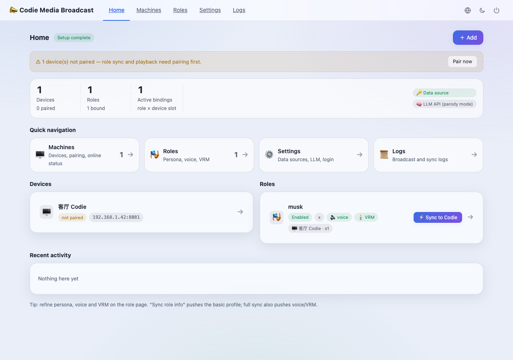

# Twitter Read Play

Monitor social-media accounts and have a **Codie** device read new posts aloud in a custom persona and voice — as a desktop app (Windows / macOS / Linux) or a self-hosted server. One codebase and one UI power both.

English · [中文](README.zh.md) — Full guide with screenshots: [guide/USAGE.md](guide/USAGE.md) ([中文](guide/USAGE.zh.md) · PDF in `guide/`)



## Quick start

**Desktop** — grab the installer from the latest [GitHub Release](https://github.com/codiebitcoin/twitter_read_play/releases): Windows `.exe` / NSIS setup, macOS `.dmg`, Linux `.deb` / AppImage. Open the app and the console window comes up directly.

**Server (Docker)** — one command with the prebuilt GHCR image:

```bash
docker run -d -p 8080:8080 -v trp-data:/app/data \
  -e AUTH_USER=admin -e AUTH_PASS=change-me \
  ghcr.io/codiebitcoin/twitter_read_play:latest
# open http://localhost:8080 and sign in
```

## Use it

1. **Initialize & sign in** — the first visit asks you to set the admin account and password (or preset them via the `AUTH_USER` / `AUTH_PASS` env; the password is stored as a bcrypt hash), then manage it under Settings → Account.
2. **Add a device** — the + Add wizard discovers Codie devices on your LAN and walks you through pairing (enter the 6-digit code shown on the device).
3. **Set up a role** — a role bundles the persona prompt, cloned voice and VRM avatar.
4. **Bind a slot** — assign the role to a device slot, then sync (voice clone + VRM) to the device.
5. **Point it at an account** — add a data source (e.g. a socialdata.tools API key) and the account handle, enable watching.
6. New posts are fetched on a schedule and **read aloud by the device** in that persona and voice; broadcast history lands under Logs.

Sign-in credentials priority: value saved under Settings → Account (stored as a bcrypt hash) > `AUTH_USER` / `AUTH_PASS` env (plaintext, for bootstrapping only). With neither set, the sign-in page asks you to create the account on first open — there is no built-in default password.

## Desktop packages

| Platform | Artifacts | Runtime |
|---|---|---|
| Windows | `Twitter Read Play.exe` (portable) + `Setup` (NSIS installer) | WebView2 (built into Win10/11) |
| Linux | `.AppImage`, `.deb`, `.tar.gz`, `install.sh` | WebKitGTK (`libwebkit2gtk-4.1-0`) |
| macOS | `Twitter Read Play.app` (universal) + `.dmg` | none |

## Build from source

```bash
git clone --recurse-submodules https://github.com/codiebitcoin/twitter_read_play.git
cd twitter_read_play
make front build   # React UI (front/) → embedded via go:embed
./dist/twitter_read_play -addr :8080 -data ./data
```

## Packaging (GitHub Actions)

`.github/workflows/release.yml`:

- **Tag** (`git tag v1.0.0 && git push origin v1.0.0`) builds all three platforms and attaches the packages to a Release, and builds the server image to GHCR (`ghcr.io/codiebitcoin/twitter_read_play:<version>` + `:latest`).
- **Manual** (Actions → Release → Run workflow) uploads the platform artifacts without cutting a Release or pushing the image.

## Documentation

- Usage guide with screenshots: [guide/USAGE.md](guide/USAGE.md) (English) · [guide/USAGE.zh.md](guide/USAGE.zh.md) (中文) · PDFs in `guide/`
- Desktop internals: [docs/desktop.md](docs/desktop.md)
- Setup wizard: [docs/navigation-wizard.md](docs/navigation-wizard.md)
