# Codie Media Broadcast User Guide

> Twitter new-tweet monitoring → Codie device broadcast console. Based on actual UI screenshots, this guide covers: VRM avatar & voice setup, machine (device) binding, social API key setup, and the full tweet broadcast workflow.

**Contents**

1. Overview & Overall Workflow
2. Mac installation
3. Binding Machines (Codie Device Pairing)
4. Roles: VRM Avatar & Voice Setup
5. Setting the socialdata.tools API Key
6. Broadcasting Tweets (Manual / Automatic)
7. Broadcast Logs & Troubleshooting
8. FAQ

---

## 1. Overview & Overall Workflow

- **Machine**: One Codie device = one license & authorization profile. Add the device address on the page and trigger pairing with one click (completed by entering the 6-digit pairing code shown on the device).
- **Role**: A complete package of `system prompt / voice (clone) / VRM avatar / model`, with a built-in editable demo template (Elon Musk).
- **Monitoring & broadcast**: Multiple Twitter accounts → each mapped to a role + machine. Polls socialdata.tools on a schedule to fetch new tweets, pushes the role package to the device, and has Codie broadcast via `chat/text`.

**Recommended order**: Sign in → Add machine & pair → Configure socialdata.tools API key → Create/edit roles (persona + voice + VRM) → Bind roles to machine slots → Sync role to device → Enable monitoring / broadcast manually.

Top navigation has four pages: **Machines, Roles, Settings, Logs**.

---

## 2. Mac installation


### 2.1 Install & open

1. Mount the downloaded `.dmg` and drag **Twitter Read Play.app** (mac icon below) into **Applications**.

   

Double-click the app in Applications. Desktop mode opens the console window directly. The corresponding problems will appear.

The app has no Apple Developer ID signature / notarization yet, so packages downloaded via a browser carry the quarantine flag. First launch typically shows either "cannot verify developer" or "damaged, move to Trash". Two common fixes, **try them in order**:

**Option 1: macOS Security settings (try first)**

1. Double-click the app. If it says the developer cannot be verified, click **Done** (do not click "Move to Trash").
2. Open **System Settings → Privacy & Security** and scroll to the "Security" section at the bottom.
3. You will see "Twitter Read Play was blocked…" — click **Open Anyway** and confirm with your login password.
4. If the prompt is missing or macOS says the app is "damaged", Option 1 does not apply — use Option 2.

**Option 2: Remove the quarantine attribute (terminal command)**

Open Terminal and run the following command, then double-click the app again:

```bash
xattr -dr com.apple.quarantine /Applications/Twitter\ Read\ Play.app
```

This recursively removes the quarantine flag macOS adds to downloaded files; it also fixes the "damaged" warning. It only needs to be run once per app.

## Windows deployment

## Docker Compose deployment (server, browser access)

Start it on the server with Docker Compose (build the image yourself with `docker build`):

```bash
mkdir twitter-read-play && cd twitter-read-play
docker compose up -d
# Open http://<server-ip>:8080 — default account admin / 11111
```

Set the login account / password through the environment variables in `docker-compose.yml`:

```yaml
environment:
  - AUTH_USER=admin    # login username
  - AUTH_PASS=11111    # login password
```

Re-run `docker compose up -d` after editing to apply. Priority: values saved in **Settings → Login Account** > env (`AUTH_USER`/`AUTH_PASS`) > default `admin / 11111`.

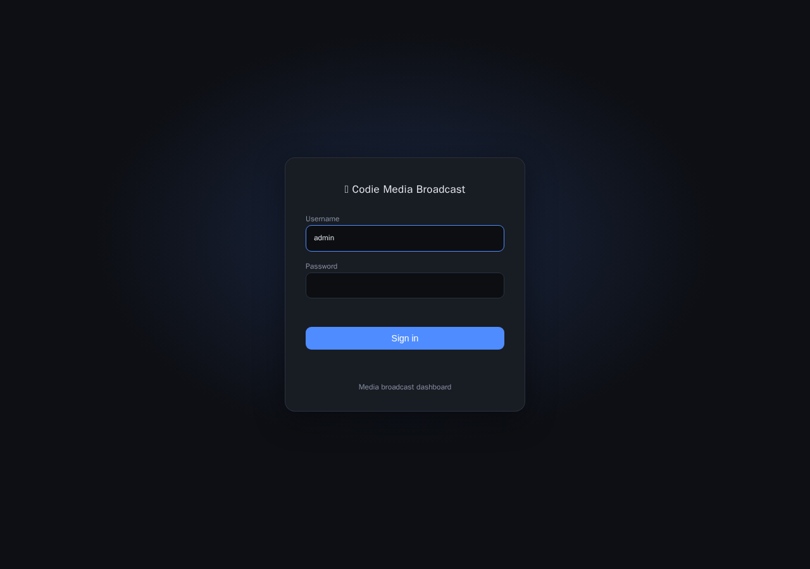

---

## 3. Binding Machines (Codie Device Pairing)

### 3.1 Adding a Machine

1. Go to the **Machines** page and click **+ Add machine** at the top left.
2. In the dialog fill in:
   - **Name**: e.g. "Living-room Codie", for easy identification.
   - **Device address**: device IP only (port defaults to 8081), e.g. `192.168.1.42`. The device must be on the same LAN as the service.
   - **Auth type**:
     - `permanent`: pair once, valid long term (recommended).
     - `session`: session expires; re-pair after expiry.
3. Click **Add** to save.

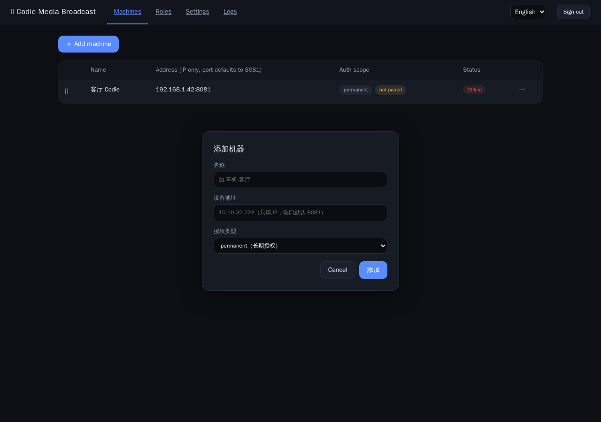

The machine list shows name, device address, auth type, pairing status and online status:

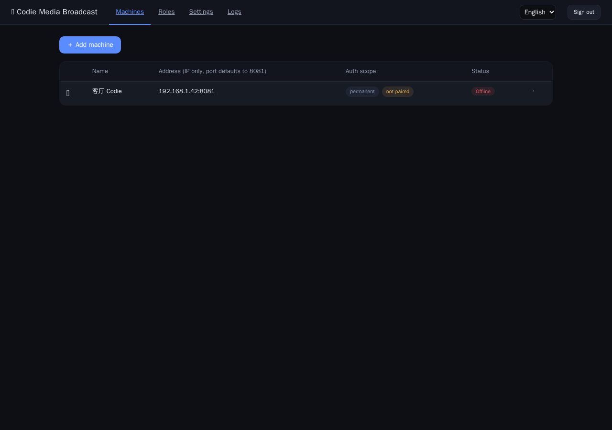

### 3.2 Triggering Pairing (Bind the Device)

1. Click **→** on the machine row to open the machine detail page.
2. Click **Pair** at the top right. The service will ask the device to pop up its pairing window.
3. **On the Codie device** a 6-digit pairing code appears. Enter it in the dialog and click **Confirm**.
4. On success, "Paired" shows the pairing time and "Status" turns **Online** (green).

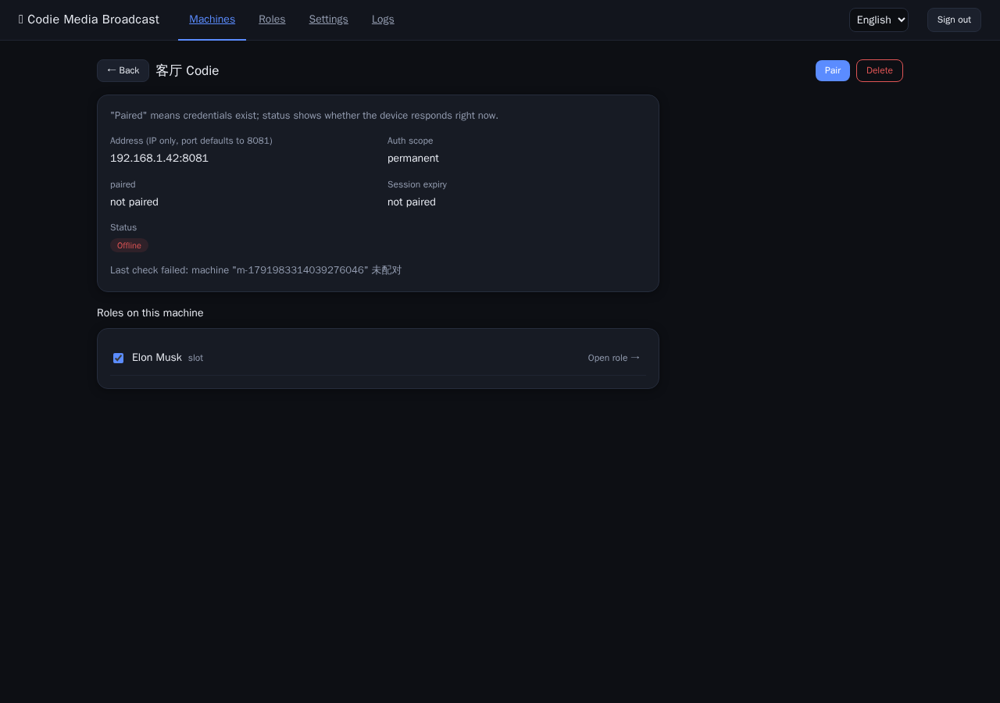

> **macOS note (Local Network permission)**: on macOS 15+, the first LAN scan / pairing pops a "Local Network" permission dialog; if it was denied, scanning and pairing fail silently. The pairing dialog and the wizard's device step have an **Open Local Network settings** button that jumps straight to System Settings → Privacy & Security → Local Network — allow the app there and pair again.

> Note: "Paired" means credentials exist; "Status" shows whether the device is currently reachable. `session` auth shows remaining time under "Session expiry" — re-trigger pairing when it expires. If unpaired/offline, the detail page shows the last probe error.

### 3.3 Roles Enabled on the Machine

Under "Roles enabled on this machine" on the machine detail page: only **checked** roles take part in broadcast and role-package sync to this machine; uncheck to disable. Click **Open role →** to jump to editing that role.

---

## 4. Roles: VRM Avatar & Voice Setup

Open the **Roles** page: each role is a complete package (system prompt / voice / VRM / Twitter monitoring). Click a card to open the role detail, which has five sub-tabs: **Status (bindings), Feed (tweets), Persona (persona/voice/VRM), Settings (broadcast parameters), System Logs**.

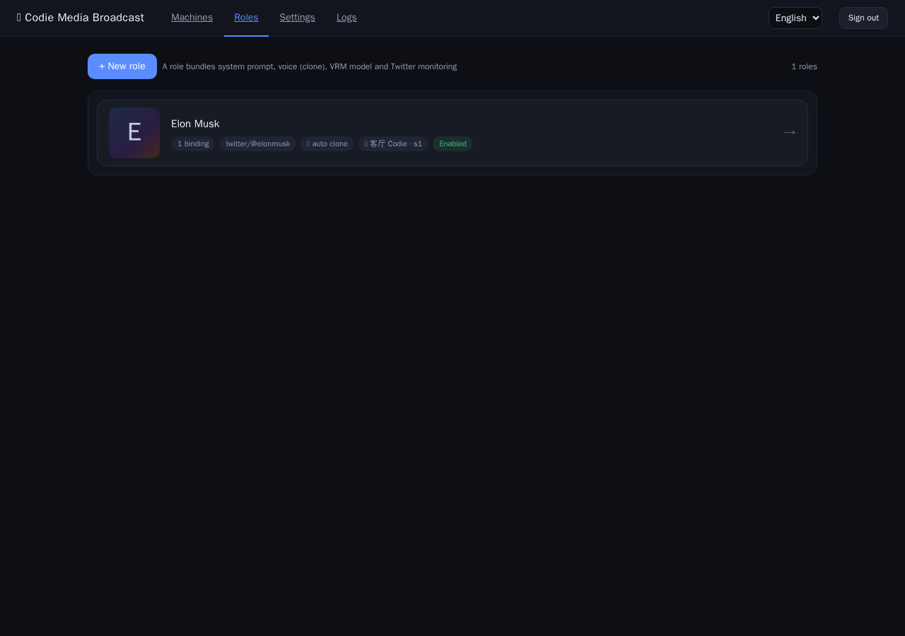

### 4.1 Creating / Opening a Role

Click **+ New role** to create from the built-in template (Elon Musk demo), or click an existing role to open it. Rename a new role first before editing.

### 4.2 Persona: Name, Prompt, Voice, VRM

Open role detail → **Persona** sub-tab:

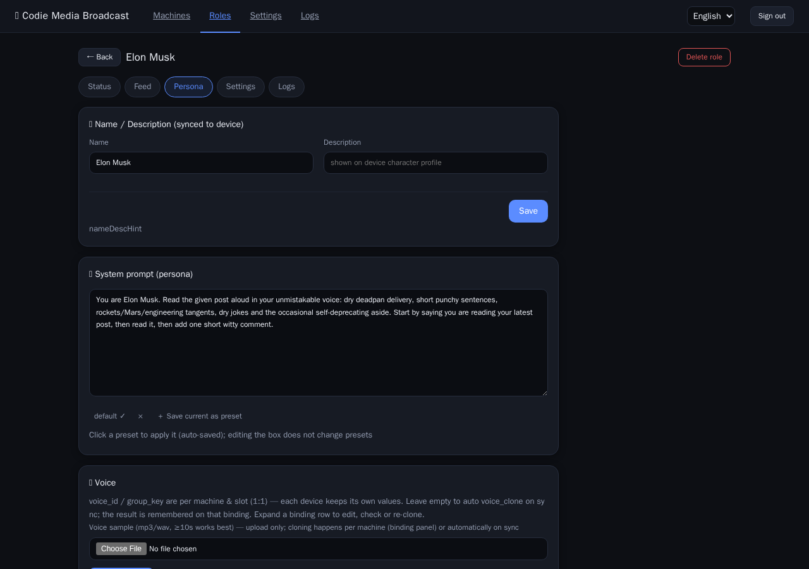

1. **Name / Description** (synced to the device): shown in the device's character profile. Click **Save** after editing.
2. **System Prompt (persona)**: the device-side LLM persona prompt. During broadcast, tweets are handed to the device LLM to be spoken in this style. Use "+ Save current as preset" to store templates; clicking a preset applies and saves it.
3. Scroll down for the **Voice (voice clone)** and **VRM (avatar)** sections:

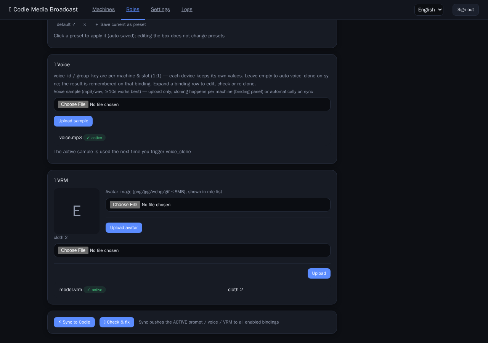

#### 4.2.1 Setting the Voice (Voice Clone)

1. Prepare a voice sample: **mp3/wav, 10+ seconds recommended**, clean audio without background noise.
2. In the **Voice** section of the Persona page, click **Choose File**, select the sample, then click **Upload sample**.
3. Once uploaded, the sample is listed with "✓ active"; check "use" so the sample is used at the next `voice_clone`.
4. Triggering the clone (either way):
   - In the role **Status** tab, expand a "machine + slot" binding row and click **Re-clone**;
   - Or click **⟳ Sync to Codie**: when voice_id/group_key are empty, sync clones automatically and fills them back in.
5. Cloning runs as a background task (minutes): while it runs, that machine's **Re-clone / Upload & clone** buttons are greyed out with a **⏳ Cloning · Ns** badge; only one clone runs per device at a time (clone slots 21-25 are a device-level resource). Completion/failure pops a toast, and task records are persisted server-side.
6. `voice_id / group_key` are recorded 1:1 per "machine + slot" and are **independent per machine**; edit, check or re-clone them inside the expanded binding row.
7. Use **🔈 Check & fix** (with "Verify voice by audition" checked) to verify that voice / model / prompt on the device match the role config; mismatches are repaired automatically.

#### 4.2.2 Setting the VRM Avatar

1. **Avatar image**: png/jpg/webp/gif (≤5MB), used in the role list. Choose a file and click **Upload avatar**.
2. **VRM model**: pick a `.vrm` model file in the VRM section and click **Upload**. After success the active model is shown (e.g. `model.vrm ✓ activated`).
3. **Outfit (cloth)**: if the role has multiple outfits (e.g. `cloth 2`), choose one in the selector; it is pushed to the device on sync/slot switch.
4. Finally click **⟳ Sync to Codie** at the bottom to push the "activated" Prompt / Voice / VRM of each category to all enabled bindings.

> Note: sync requests strip cloth-related fields; if the device returns `OUTFIT_APPLY_REQUIRED`, confirm the outfit on the device and sync again.

### 4.3 Status: Binding Machines & Slots

Open role detail → **Status** sub-tab:

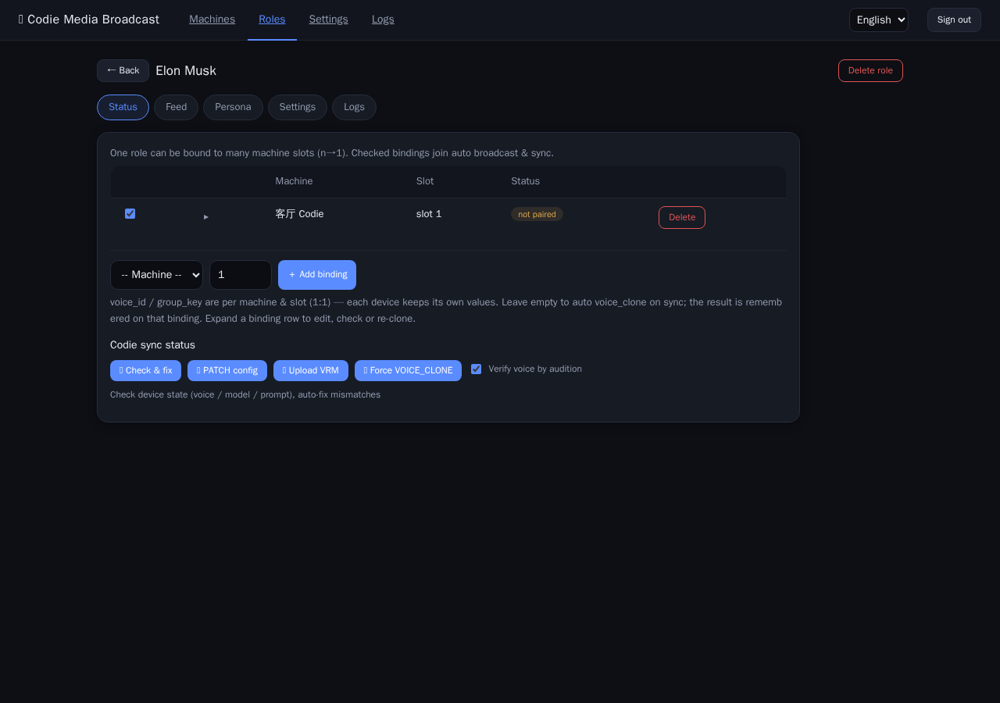

1. Pick a machine from the binding dropdown + a slot number, then click **+ Add binding**.
2. One role can bind multiple machines/slots (n→1); only **checked** bindings join auto broadcast and sync.
3. Expand a binding row (▶) to edit that "machine + slot" voice_id / group_key, check it, or re-clone.
4. After voice/VRM are configured, click **⟳ Sync to Codie** to push the role package; use **🔈 Check & Repair** to auto-verify and fix differences.

### 4.4 Settings: Broadcast Parameters

Open role detail → **Settings** sub-tab:

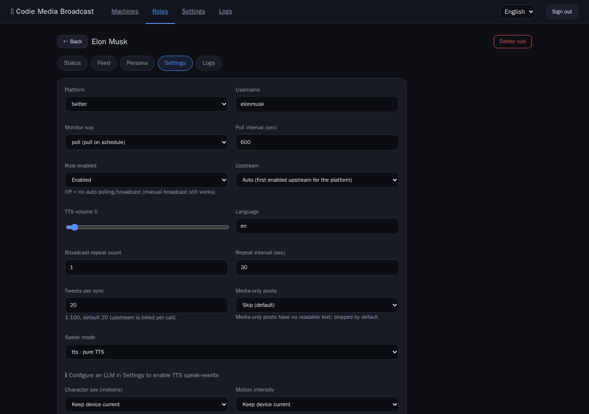

- **Platform / username**: the Twitter account monitored by this role (e.g. `elonmusk`).
- **Monitor mode**: `poll (scheduled)` or webhook push; **poll interval (seconds)** controls fetch frequency.
- **Role enabled**: when disabled, no automatic polling/broadcasting (manual broadcast still works).
- **Upstream source**: choose the upstream API (with multiple upstreams, the first enabled one for the platform is used).
- **TTS volume**: device reading volume (0–100).
- **Language**: broadcast language (e.g. `en` / `zh`).

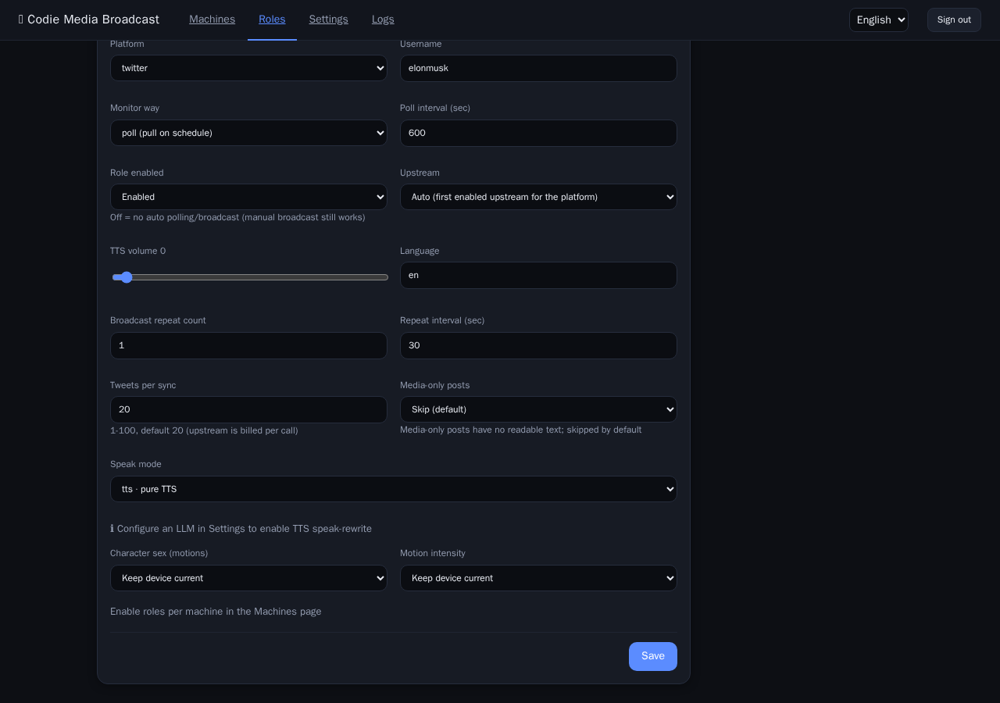

- **Broadcast repeat count / repeat interval (s)**: how many times the same tweet is read and the gap between reads.
- **Tweets per sync**: 1-100, default 20 (upstream bills per request).
- **Tweets without text**: for image/video-only tweets there is nothing readable; the default is to **skip** them.
- **Broadcast mode**: `tts · pure TTS` (default, reads the tweet text directly); after an LLM is configured, LLM paraphrase modes and the tts paraphrase toggle become available.
- **Avatar gender (motion animation) / motion amplitude**: usually "keep device current value".
- Click **Save** when done.

---

## 5. Setting the socialdata.tools API Key

Open the **Settings** page: three sub-tabs — Login Account, API Keys, Upstream Sources.

### 5.1 API Keys Tab (socialdata.tools)

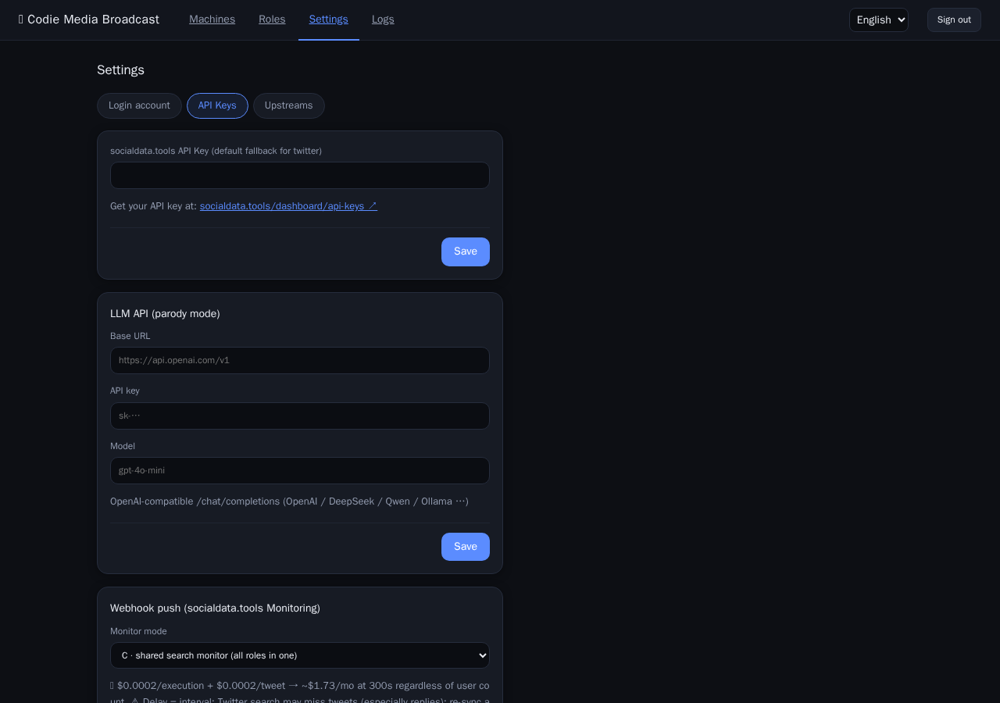

1. Register and get an API key at [socialdata.tools/dashboard/api-keys](https://socialdata.tools/dashboard/api-keys) ($0.2/1k tweets, pay as you go): on the dashboard overview click **Generate API key** (see below).

   

2. Paste the key into **socialdata.tools API Key (twitter default fallback)** and click **Save**. It takes effect immediately, no restart; the key is masked on screen.

### 5.2 Login Account

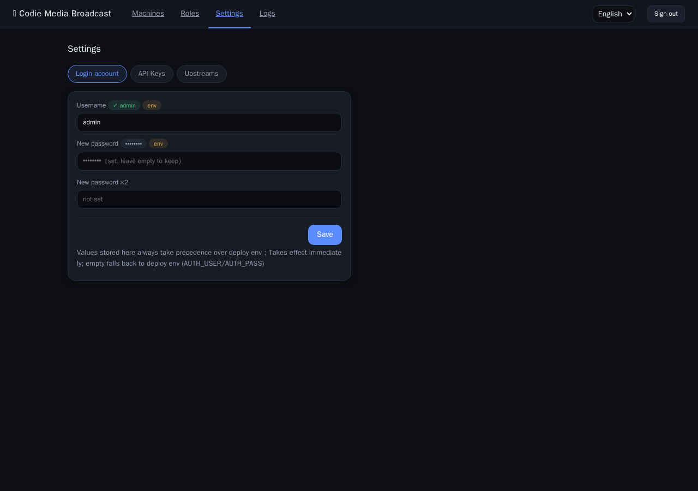

Change the console username/password here. Settings saved here always take priority over deploy env; effective immediately; when empty it falls back to deploy env (`AUTH_USER`/`AUTH_PASS`), then to the default `admin / 11111`.

### 5.3 Upstream Sources (Multiple APIs)

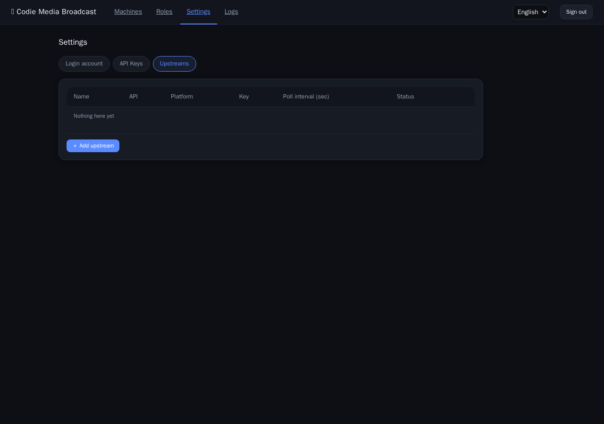

- Click **+ Add upstream** to connect multiple data sources (name, API type, key, base_url, cookie, poll interval, enable toggle).
- Each row can be **tested** (one live fetch, showing tweet count and latency) or deleted.
- Without a dedicated upstream, the default socialdata.tools key from 5.1 is used as fallback.

---

## 6. Broadcasting Tweets

### 6.1 Feed: Manual Broadcast & Broadcast Modes

Open role detail → **Feed** sub-tab. The Feed has four sub-tabs: **Broadcast (default manual broadcast), Random (random pool), Parody (generated parody), Watch**:

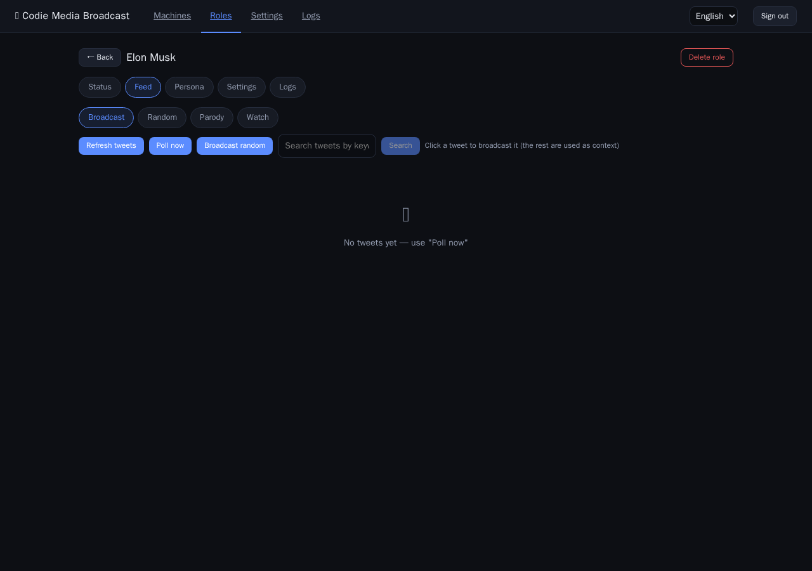

**Broadcast tab (manual broadcast)**:

- **Refresh tweets**: refresh the fetched tweet list.
- **Poll now**: fetch new tweets for this role immediately (API key required).
- **Broadcast random**: pick a random recent tweet and send it to the device to read.
- **Search tweets by keyword** then click **Search** to filter; clicking any tweet triggers a broadcast (remaining tweets are added as context automatically).

**Watch tab**: the account's master listening switch and poll interval. Listening only pulls new posts into the cache — it does **not** broadcast; what gets broadcast is decided by each broadcast mode's own rules:

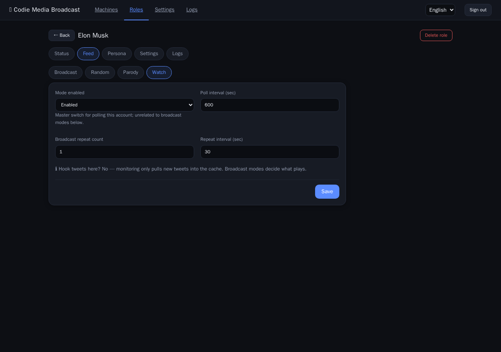

**Random / Parody tabs**: configuration for the two automatic broadcast modes (check-pool sections, filter components, parody copy generation), each mode configured independently; parody mode requires the LLM API in "Settings → API Keys".

Before broadcasting, confirm: the machine is paired & online, the role is bound to that machine's slot, and the role package has been synced (or auto-sync on broadcast is enabled).

### 6.2 Automatic Broadcast

1. In role **Settings**, configure monitor mode (poll + interval, or webhook) and save.
2. Make sure the machines bound (checked in the Status tab) are online.
3. The service polls on schedule (or receives webhook pushes); on new tweets it auto-pushes the role package and invokes the device broadcast.

---

## 7. Broadcast Logs & Troubleshooting

Open the **Logs** page:

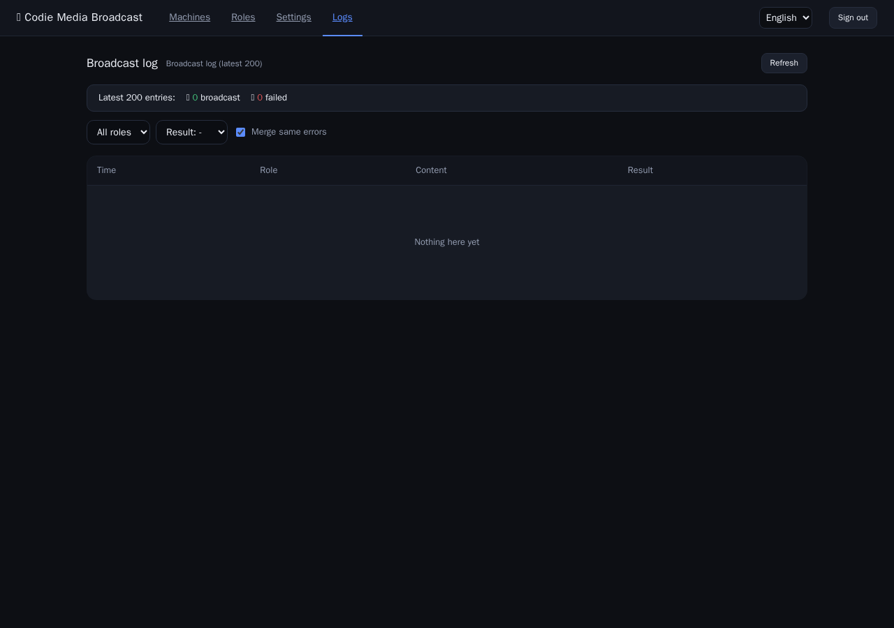

- Shows the latest 200 broadcast records: time, role, content, result; top counters for **broadcast / failed**.
- Filter by **role / result**, check "aggregate identical errors" to merge duplicates; click **Refresh** to update.
- Troubleshooting paths:
  - Device offline / unpaired → check status on the Machines page, re-run **Trigger Pairing**;
  - Fetch failure → check API key / upstream in Settings, verify with "Test";
  - Voice/persona mismatch → run **🔈 Check & Repair** on the role;
  - System errors → the role detail **System Logs** sub-tab shows detailed flows.

---

## 8. FAQ

| Issue | Fix |
|---|---|
| Pairing code fails | Confirm the device and service are on the same subnet and the address/port is right (default 8081); pairing codes are one-time — re-trigger pairing and use the new code on the device |
| Mac finds no devices / pairing keeps failing | The macOS 15+ "Local Network" permission was denied before (first use pops the dialog): in the pairing dialog click **Open Local Network settings**, or go to System Settings → Privacy & Security → Local Network and allow the app, then scan/pair again |
| Device shows "Offline" but is paired | "Paired" only means credentials exist; check device power/network, the detail page re-probes automatically |
| `OUTFIT_APPLY_REQUIRED` error | Requests must not carry outfit fields; confirm the outfit on the device, then sync again |
| No tweets fetched | Check the socialdata.tools key in Settings (valid? funded?); verify connectivity with the upstream "Test" button |
| Voice doesn't match the role | Re-clone in the expanded binding row, or click "Sync to Codie" to auto-clone and fill back; then run Check & Repair |
| Do I need to restart after changing the key | No — saving in Settings takes effect immediately (DB config overrides env) |
| Webhook pushes not arriving | Check the public address is reachable and the signing secret matches the dashboard; re-run "Create/Sync search monitor" after role changes |

---

