# Codie Media Broadcast 使用手册

> Twitter 新推文监控 → Codie 设备播报控制台。本手册基于实际界面截图，覆盖：VRM 形象与声音设置、机器（设备）绑定、social API Key 设置、推文播报的完整流程。

**目录**

1. 产品简介与整体流程
2. Mac安装
3. 绑定机器（Codie 设备配对）
4. 角色管理：VRM 形象与声音设置
5. 设置 socialdata.tools API Key
6. 推文播报（手动 / 自动）
7. 播报日志与排错
8. 常见问题 FAQ

---

## 1. 产品简介与整体流程

- **机器**：一台 Codie 设备 = 一份授权与授权配置。页面上添加设备地址后一键触发配对（输入设备上的 6 位配对码完成）。
- **角色**：`system prompt / 声音（voice clone）/ VRM 形象 / 模型` 打包为一个整体，内置可编辑的 demo 模板（Elon Musk）。
- **监控播报**：多个 Twitter 用户 → 各自映射到角色 + 机器，定时轮询 socialdata.tools 拉取新推文，把角色包下发到设备后经 `chat/text` 让 Codie 播报。

**推荐操作顺序**：登录 → 添加机器并完成配对 → 配置 socialdata.tools API Key → 新建/编辑角色（人设 + 声音 + VRM）→ 角色绑定机器槽位 → 同步角色到设备 → 开启监控/手动播报。

顶部导航共四页：**机器、角色、设置、日志**。

---

## 2. Mac安装


### 2.1 安装与打开

1. 打开下载的 `.dmg` 镜像，把 **Twitter Read Play.app**（mac 图标如下）拖入「Applications（应用程序）」文件夹。

   

在「应用程序」中双击打开。桌面模式开窗即进控制台。会出现相应的问题

App 暂未购买 Apple 开发者签名 / 公证，从浏览器下载的包会带隔离（quarantine）标记，首次打开常见两种拦截提示：「无法验证开发者」或「已损坏，移到废纸篓」。两种常见解决方式，**按顺序尝试**：

**方式一：macOS 安全设置（推荐先试）**

1. 双击 App，若弹出「无法打开，因为无法验证开发者」，点击 **完成**（不要点「移到废纸篓」）。
2. 打开 **系统设置 → 隐私与安全性**，滚动到最底部「安全性」区域。
3. 会看到「"Twitter Read Play" 已被阻止，来自身份不明的开发者」，点击旁边的 **仍要打开**，输入开机密码确认即可。
4. 若底部没有该提示、或弹窗提示「已损坏」，说明方式一不适用，改用方式二。

**方式二：去除隔离属性（终端命令）**

打开「终端」（终端 / Terminal），执行下面一条命令，回车后再双击打开即可：

```bash
xattr -dr com.apple.quarantine /Applications/Twitter\ Read\ Play.app
```

该命令递归删除 macOS 给下载文件打的隔离标记（`com.apple.quarantine`），对「已损坏」提示同样有效；每个应用只需执行一次。

## Windows部署

## Docker Compose 部署（服务器浏览器访问）

服务器上用 Docker Compose 启动（镜像自行 `docker build` 构建）：

```bash
mkdir twitter-read-play && cd twitter-read-play
docker compose up -d
# 打开 http://<服务器IP>:8080，默认账号 admin / 11111
```

通过 `docker-compose.yml` 里的环境变量设置打开账号密码：

```yaml
environment:
  - AUTH_USER=admin    # 登录用户名
  - AUTH_PASS=11111    # 登录密码
```

改完执行 `docker compose up -d` 重建生效。优先级：页面「设置 → 登录账号」保存值 > env（`AUTH_USER/AUTH_PASS`）> 默认 `admin / 11111`。

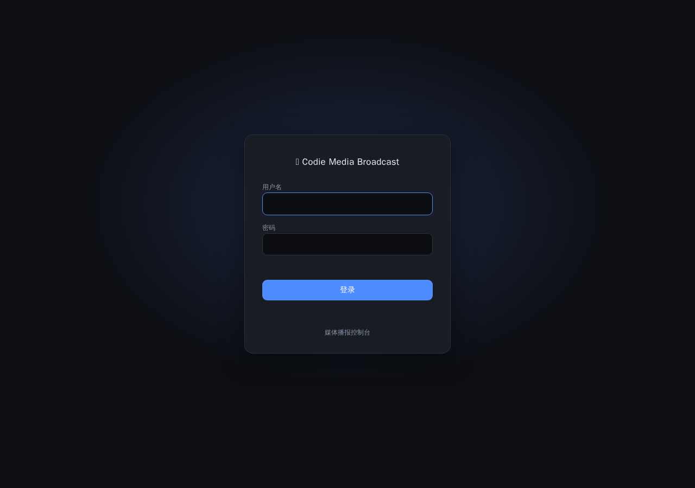

---

## 3. 绑定机器（Codie 设备配对）

### 3.1 添加机器

1. 进入顶部导航 **机器** 页，点击左上角 **＋ 添加机器**。
2. 弹窗中填写：
   - **名称**：如「客厅 Codie」「车载-客厅」，便于识别。
   - **设备地址**：只填设备 IP（端口默认 8081），如 `192.168.1.42`。设备需与服务在同一局域网。
   - **授权类型**：
     - `permanent（长期授权）`：配对一次长期有效（推荐）。
     - `session（会话授权）`：会话有到期时间，到期后需重新配对。
3. 点击 **添加** 保存。

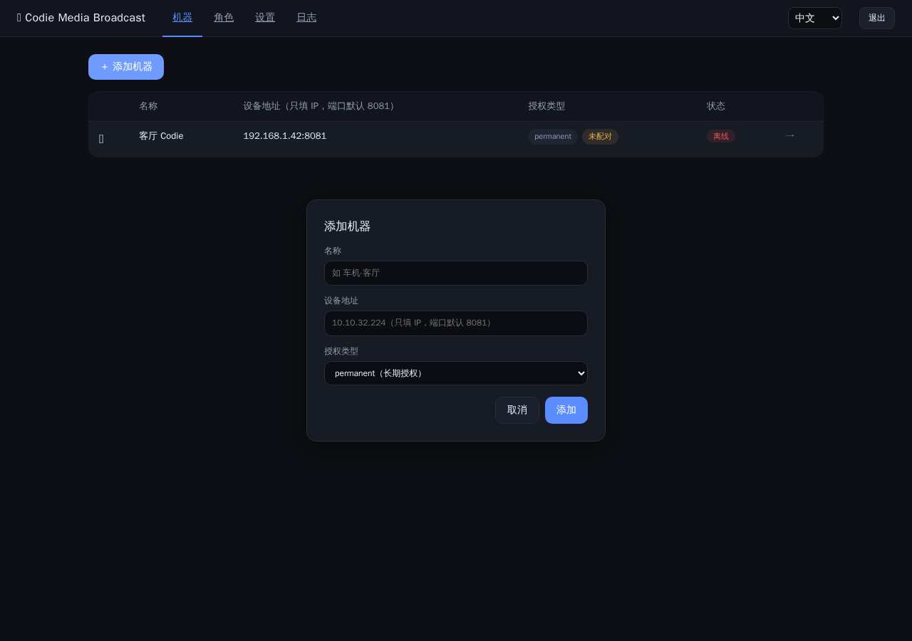

机器列表会显示名称、设备地址、授权类型、配对状态与在线状态：

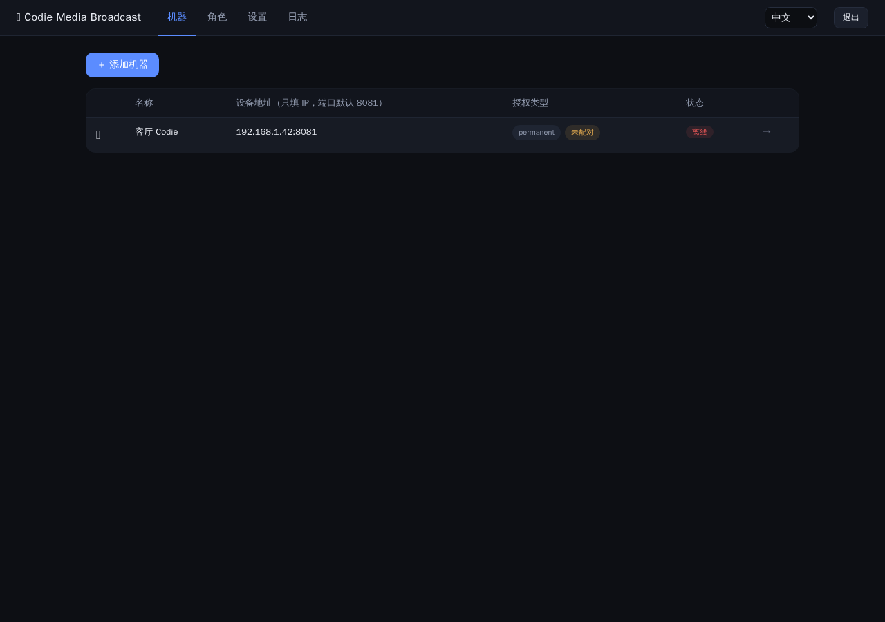

### 3.2 触发配对（绑定设备）

1. 在机器列表点击该行右侧 **→** 进入机器详情。
2. 点击右上角 **触发配对**。服务会请求设备弹出配对窗口。
3. **在 Codie 设备上**会弹出 6 位配对码，把该码填入弹窗输入框，点击 **确认配对**。
4. 配对成功后，详情页「已配对」变为配对时间，「状态」显示 **在线**（绿色）。

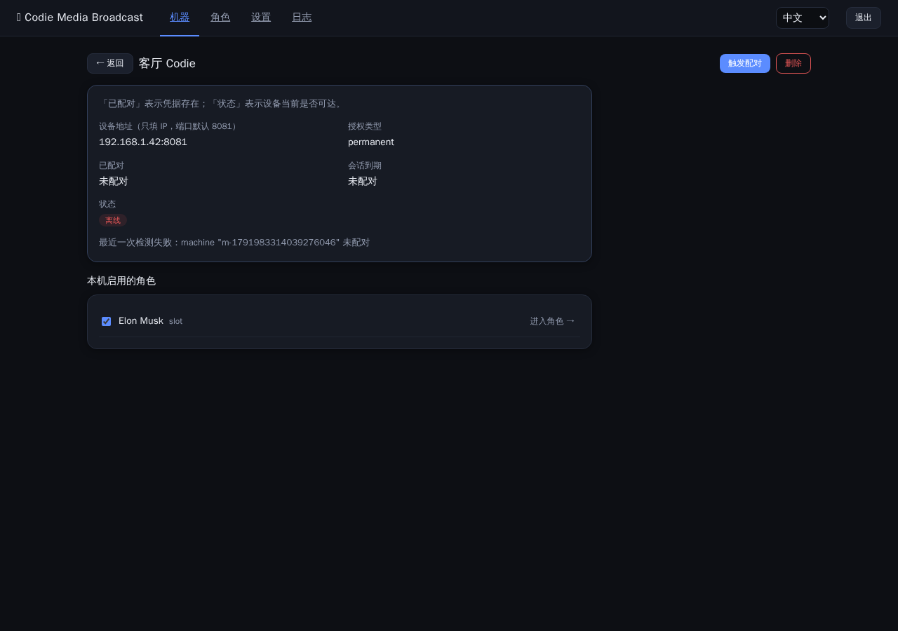

> **macOS 用户注意（本地网络授权）**：macOS 15+ 首次扫描/配对时会弹「本地网络」授权弹窗；若点了「不允许」，扫描和配对都会静默失败。此时配对弹窗与向导的设备步骤会出现 **打开局域网授权设置** 按钮（只在连接被拒/超时这类网络失败后显示），一键跳到 系统设置 → 隐私与安全性 → 本地网络，手动允许本应用后重新配对即可。

> 说明：「已配对」表示凭据存在；「状态」表示设备当前是否可达。`session` 授权会在「会话到期」处显示剩余时间，过期后重新触发配对即可。未配对/离线时详情页会显示最近一次检测失败原因。

### 3.3 本机启用角色

机器详情下方「本机启用的角色」：勾选哪些角色，播报与角色包同步就会下发到这台机器；取消勾选即停用。点击 **进入角色 →** 可跳转编辑该角色。

---

## 4. 角色管理：VRM 形象与声音设置

进入 **角色** 页：每个角色是一个完整包（system prompt / 音色 / VRM / 推特监控）。点击卡片进入角色详情，详情含 5 个子页：**Status（绑定）、Feed（推文）、Persona（人设/声音/VRM）、Settings（播报参数）、系统日志**。

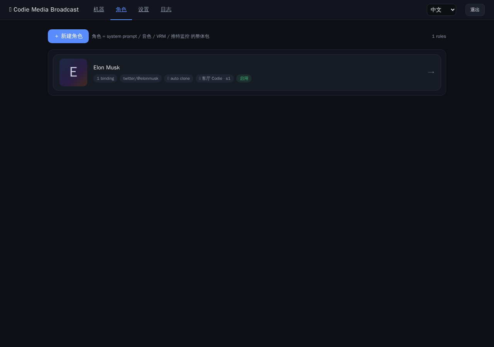

### 4.1 新建 / 进入角色

点击 **＋ 新建角色** 从内置模板（Elon Musk demo）复制创建，或在列表点击已有角色进入。新角色建议先改名再编辑。

### 4.2 Persona：名称、人设 prompt、声音、VRM

进入角色详情 → **Persona** 子页：

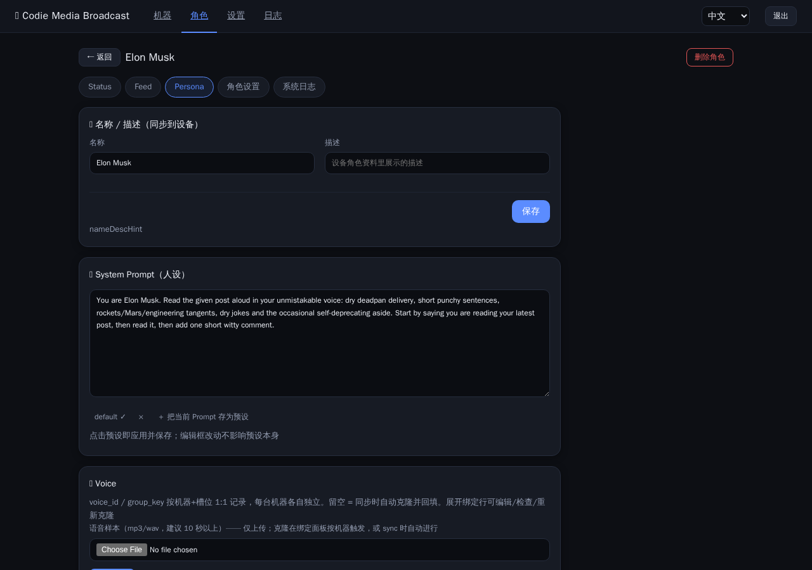

1. **名称 / 描述**（同步到设备）：设备角色资料里展示的名称与描述，改完点 **保存**。
2. **System Prompt（人设）**：设备端 LLM 的人设 prompt。播报时把推文交给设备 LLM 按此风格口语化。可用「＋ 把当前 Prompt 存为预设」保存常用模板，点击预设即应用并保存。
3. 向下滚动是 **Voice（声音克隆）** 与 **VRM（形象）** 两个区块：

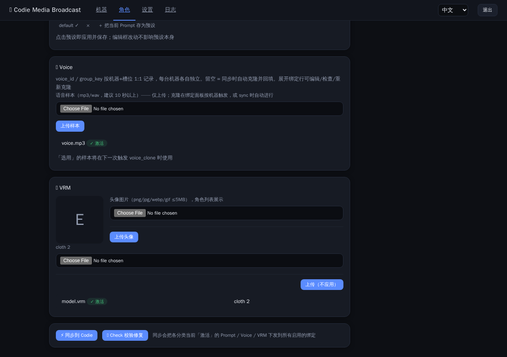

#### 4.2.1 设置声音（Voice / 音色克隆）

1. 准备语音样本：**mp3/wav，建议 10 秒以上**，音质清晰、无背景噪音。
2. 在 Persona 页 **Voice** 区块点击 **Choose File** 选择样本文件，点击 **上传样本**。
3. 上传成功后样本会列出并显示「✓ 激活」；勾选「选用」后，该样本将在下一次触发 `voice_clone` 时使用。
4. 克隆触发时机（二选一）：
   - 在角色 **Status** 页展开某条「机器+槽位」绑定行，点击 **重新克隆**；
   - 或直接点 **⟳ 同步到 Codie**：留空 voice_id/group_key 时，同步会自动克隆并回填。
5. 克隆为后台任务（分钟级）：进行中该机器的 **重新克隆 / 上传并克隆** 按钮会变灰，并显示 **⏳ 克隆中 · Ns**；同一台设备同时只跑一个克隆（克隆槽 21-25 为设备级资源）。完成/失败会弹提示，任务记录由后台持久化。
6. `voice_id / group_key` 按「机器+槽位」1:1 记录，**每台机器各自独立**；可在绑定行内手动编辑、检查或重新克隆。
7. 可用 **🔈 Check 校验修复**（勾选「试听验证音色」）核对设备上 voice / model / prompt 是否与角色配置一致，不一致会自动修复。

#### 4.2.2 设置 VRM 形象

1. **头像图片**：png/jpg/webp/gif（≤5MB），用于角色列表展示。选择文件后点 **上传头像**。
2. **VRM 模型**：在 VRM 区块选择 `.vrm` 模型文件，点击 **上传并应用**。上传成功后显示当前激活的模型（如 `model.vrm ✓ 激活`）。
3. **服装（cloth）**：如角色有多个服装（如 `cloth 2`），可在对应选择框选择；同步/切换槽位时下发到设备。
4. 最后点击底部 **⟳ 同步到 Codie**，把各分类当前「激活」的 Prompt / Voice / VRM 下发到所有启用的绑定。

> 注意：同步时请求不带服装冲突字段，若设备提示 `OUTFIT_APPLY_REQUIRED`，先在设备端确认服装后再同步。

### 4.3 Status：绑定机器与槽位

进入角色详情 → **Status** 子页：

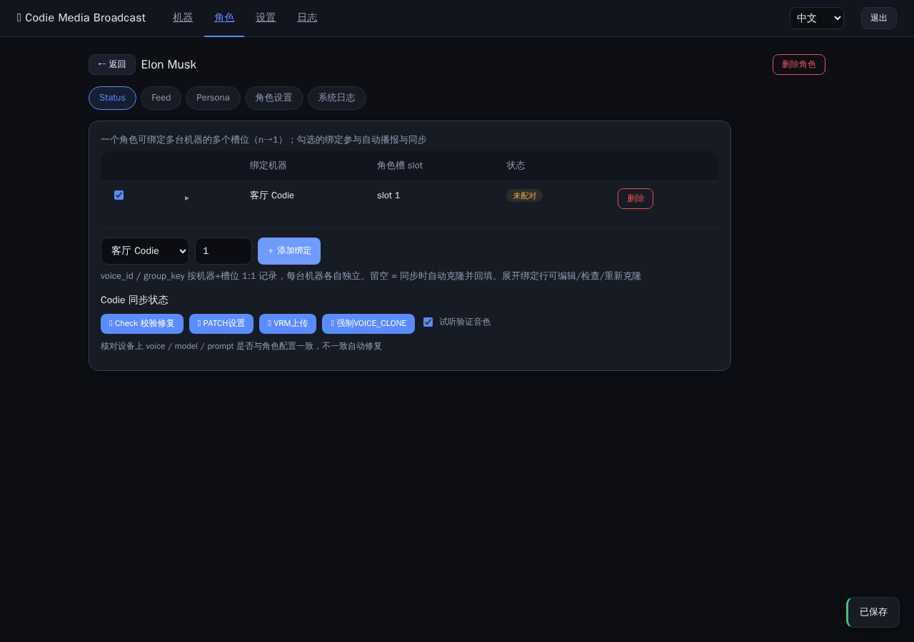

1. 选择 **绑定机器** 下拉框 + **角色槽 slot** 号，点击 **＋ 添加绑定**。
2. 一个角色可绑定多台机器的多个槽位（n→1）；**勾选**的绑定才参与自动播报与同步。
3. 展开绑定行（▶）可编辑该「机器+槽位」的 voice_id / group_key、检查或重新克隆。
4. 配好声音/VRM 后，点 **⟳ 同步到 Codie** 下发角色包；点 **🔈 Check 校验修复** 自动核对并修复差异。

### 4.4 Settings：播报参数

进入角色详情 → **Settings** 子页：

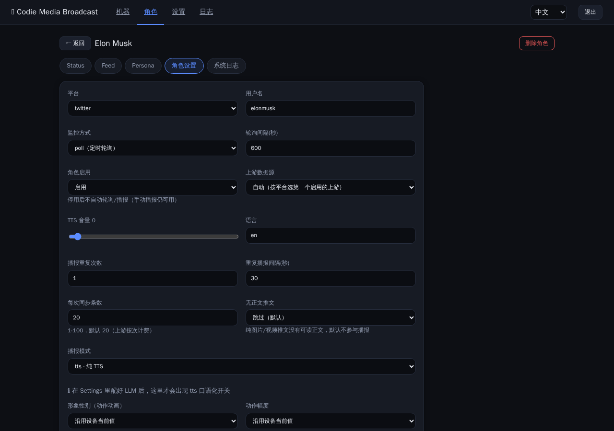

- **平台 / 用户名**：该角色监控的 Twitter 账号（如 `elonmusk`）。
- **监控方式**：`poll（定时轮询）` 或 webhook 推送；**轮询间隔（秒）** 控制拉取频率。
- **角色启用**：停用后不自动轮询/播报（手动播报仍可用）。
- **上游数据源**：选择使用的上游 API（多上游时按平台选第一个启用的）。
- **TTS 音量**：设备朗读音量（0–100）。
- **语言**：播报语言（如 `en` / `zh`）。

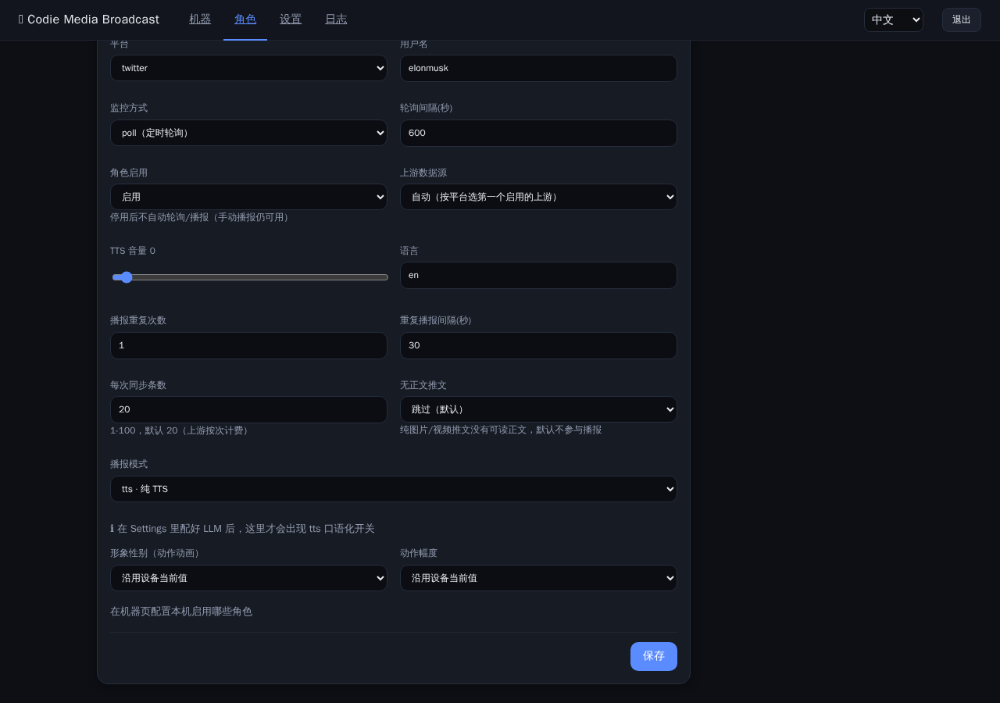

- **播报重复次数 / 重复播报间隔（秒）**：同一条推文重复朗读的次数与间隔。
- **每次同步条数**：1-100，默认 20（上游按次计费）。
- **无正文推文**：纯图片/视频推文没有可读正文时，默认「跳过」不参与播报。
- **播报模式**：`tts · 纯 TTS`（默认，直接朗读推文正文）；配置 LLM 后可选 LLM 口语化模式，并出现 tts 口语化开关与转换 prompt。
- **形象性别（动作动画）/ 动作幅度**：一般「沿用设备当前值」。
- 改完点击 **保存**。

---

## 5. 设置 socialdata.tools API Key

进入 **设置** 页，含三个子页：登录账号、API Keys、上游数据源。

### 5.1 API Keys 子页（socialdata.tools）

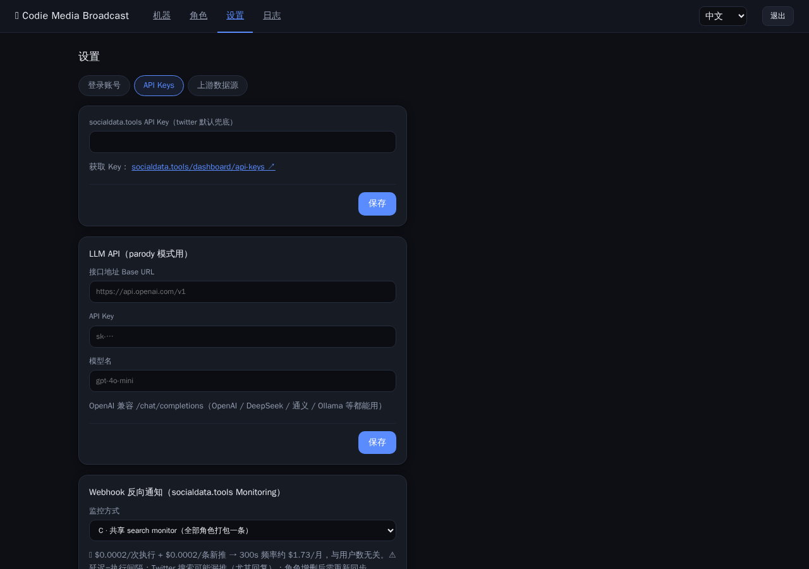

1. 到 [socialdata.tools/dashboard/api-keys](https://socialdata.tools/dashboard/api-keys) 注册并获取 API Key（$0.2/1k 条按量计费）：在 dashboard 的 Overview 页点 **Generate API key** 生成，再回到本页粘贴。

   

2. 在 **socialdata.tools API Key（twitter 默认兜底）** 输入框粘贴 Key，点 **保存**。保存即时生效，无需重启；Key 在页面上脱敏显示。

### 5.2 登录账号

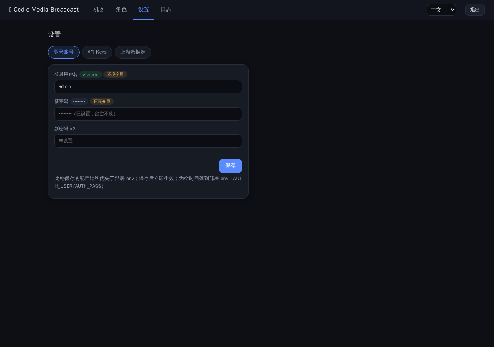

可修改控制台登录用户名/密码。此处保存的配置始终优先于部署 env；保存后立即生效；为空时依次回落到部署 env（`AUTH_USER/AUTH_PASS`）、默认值 `admin / 11111`。

### 5.3 上游数据源（多 API 源）

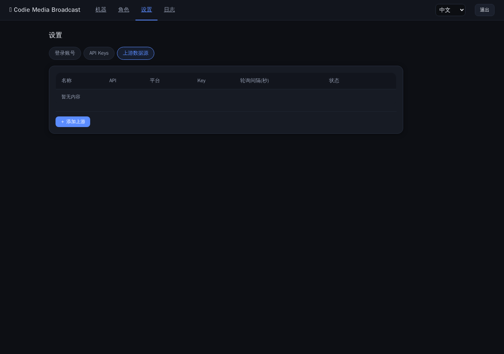

- 点击 **＋ 添加上游**，可接入多个数据源（名称、API 类型、Key、base_url、Cookie、轮询间隔、启用开关）。
- 每行可 **测试**（试拉一次推文，显示条数与耗时）或删除。
- 未配置专用上游时，使用 5.1 的默认 socialdata.tools Key 兜底。

---

## 6. 推文播报

### 6.1 Feed：手动播报与播报模式

进入角色详情 → **Feed** 子页。Feed 顶部有四个子标签：**broadcast（默认手动播报）、random（随机池）、parody（恶搞生成）、监听**：

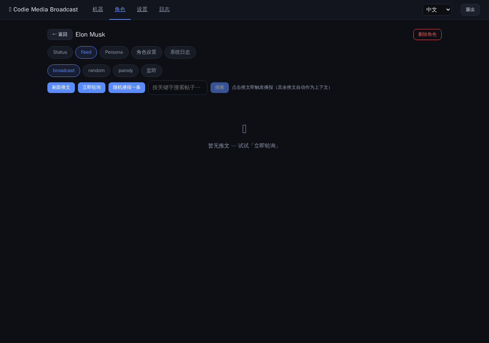

**broadcast 标签（手动播报）**：

- **刷新推文**：刷新已拉取的推文列表。
- **立即轮询**：立刻从上游拉取该角色用户新推文（需已配置 API Key）。
- **随机播报一条**：从最新推文中随机挑一条下发给设备朗读。
- **按关键字搜索帖子**后点 **搜索** 可筛选，点击任意推文即触发播报（其余推文自动作为上下文）。

**监听标签**：该账号的监听总开关与轮询间隔。监听只负责把新帖拉进缓存、**不播**，播不播、播哪些由各播报模式自己的规则决定：

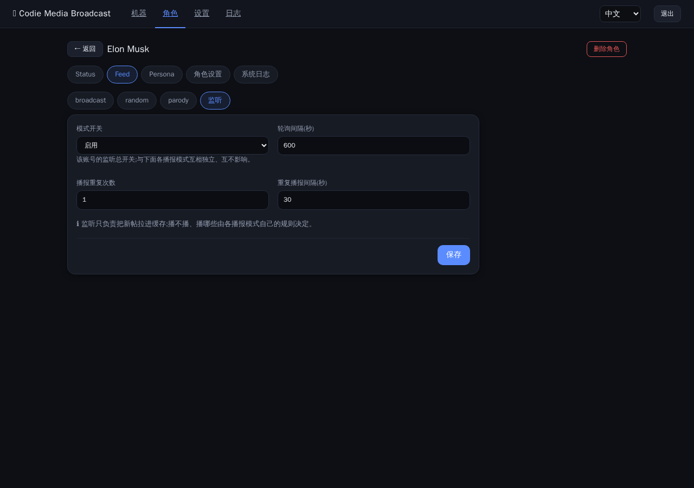

**random / parody 标签**：两种自动播报模式的配置（勾选池分区、筛选组件、parody 文案生成等），按模式归属各自独立配置；parody 模式需在「设置 → API Keys」配置 LLM API。

播报前请确认：机器已配对且在线、角色已绑定该机器槽位、角色包已同步（或勾选了播报时自动同步）。

### 6.2 自动播报

1. 在角色 **Settings** 页配置监控方式（poll + 轮询间隔，或 webhook 模式）并保存。
2. 确认角色绑定（Status 页勾选）的机器在线。
3. 服务按间隔轮询（或接收 webhook 推送），发现新推文后自动下发角色包并调用设备播报。

---

## 7. 播报日志与排错

进入 **日志** 页：

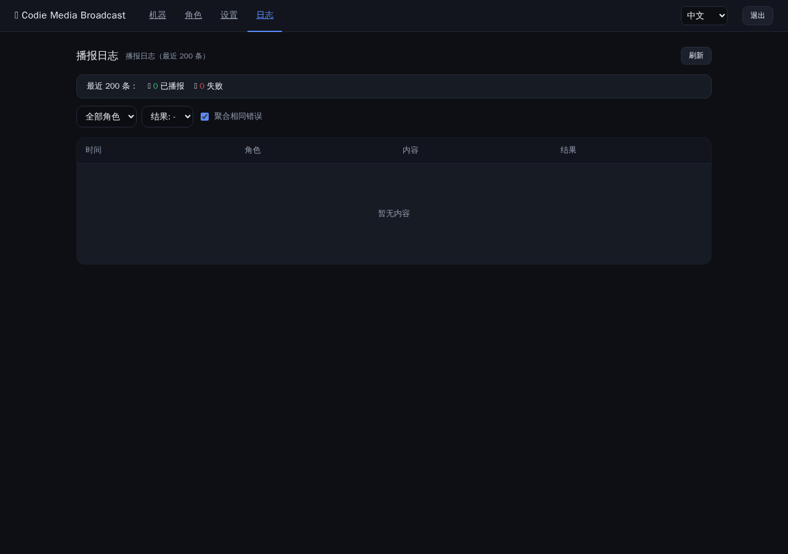

- 展示最近 200 条播报记录：时间、角色、内容、结果；顶部统计 **已播报 / 失败** 数量。
- 可按 **角色 / 结果** 过滤，勾选「聚合相同错误」合并重复报错；点 **刷新** 更新。
- 排错路径：
  - 设备离线/未配对 → 机器页看状态，重新 **触发配对**；
  - 拉取失败 → 设置页检查 API Key / 上游，用「测试」验证；
  - 音色/人设不符 → 角色页点 **🔈 Check 校验修复**；
  - 系统级报错 → 角色详情 **系统日志** 子页查看详细流水。

---

## 8. 常见问题 FAQ

| 问题 | 处理 |
|---|---|
| 配对码输入后失败 | 确认设备与服务同网段、地址端口正确（默认 8081）；配对码是一次性的，重新点「触发配对」用设备新弹出的码 |
| Mac 扫描不到设备/配对一直失败 | macOS 15+ 的「本地网络」授权被拒绝过（首次会弹窗）：在报错后出现的 **打开局域网授权设置** 按钮，或手动去 系统设置 → 隐私与安全性 → 本地网络 允许本应用，再重新扫描/配对 |
| 设备显示「离线」但已配对 | 「已配对」仅代表凭据存在；检查设备电源/网络，详情页会自动重测 |
| `OUTFIT_APPLY_REQUIRED` 报错 | 请求不允许携带服装字段；在设备端先确认服装，再重新同步 |
| 拉取不到推文 | 设置页检查 socialdata.tools Key 是否有效、是否欠费；上游「测试」按钮验证连通 |
| 声音和角色不符 | 绑定行展开重新克隆，或直接「同步到 Codie」自动克隆回填；再用 Check 校验修复 |
| 改了 Key 要重启吗 | 不需要，设置页保存后立即生效（数据库配置优先于 env） |
| webhook 推送收不到 | 检查公网地址可达、签名密钥与 dashboard 一致；角色增删后重新「创建/同步 search monitor」 |

---

