# Codie Media Broadcast User Guide

> Monitor social-media accounts and have a Codie device read new posts aloud in a custom persona and voice. Based on the current UI, with screenshots for each step: installation, device pairing, persona/voice/VRM setup, data-source API keys, and the full broadcast workflow.

**Contents**

1. Overview & workflow
2. Installation (macOS / Windows / Linux / Docker)
3. Home & top navigation
4. Bind a device (Codie pairing)
5. Roles: persona, voice and VRM
6. Data source & API key
7. Broadcasting posts (manual / automatic)
8. Logs & troubleshooting
9. FAQ

---

## 1. Overview & workflow

- **Machine** — one Codie device = one authorization profile. Add the device address on the page, then trigger pairing (enter the 6-digit code shown on the device).
- **Role** — a single bundle of `system prompt / cloned voice / VRM avatar / monitored account`. A demo role (Elon Musk) ships built-in and is editable.
- **Monitor & broadcast** — map several social-media accounts to roles and machines. The service polls the upstream source for new posts on a schedule, pushes the role bundle to the device, and has Codie read the post aloud via `chat/text`.

**Recommended order**: sign in → add a device and pair it → set the data-source API key → create/edit a role (persona + voice + VRM) → bind the role to a device slot → sync the role → enable watching / broadcast manually.

---

## 2. Installation

### 2.1 Desktop (recommended)

Download from the latest [GitHub Release](https://github.com/codiebitcoin/twitter_read_play/releases) and run it — the console opens in a desktop window.

| Platform | Package | Notes |
|---|---|---|
| macOS | `Twitter Read Play.app` + `.dmg` (universal) | first-open quarantine fix below |
| Windows | `Twitter Read Play.exe` (portable) / `Setup` (NSIS) | needs WebView2 (built into Win10/11) |
| Linux | `.AppImage` / `.deb` / `.tar.gz` | needs WebKitGTK (`libwebkit2gtk-4.1-0`) |

**macOS first-open quarantine.** The package is not signed with an Apple Developer ID / notarized, so a download carries the quarantine flag. If macOS blocks the first launch ("cannot verify developer" or "damaged, move to Trash"), try in order:

1. Double-click the app. If it says the developer cannot be verified, click **Done** (not "Move to Trash"), then open **System Settings → Privacy & Security** → scroll to "Security" and click **Open Anyway**.
2. If that does not appear, open Terminal and run, then relaunch:

```bash
xattr -dr com.apple.quarantine /Applications/Twitter\ Read\ Play.app
```

### 2.2 Server (Docker)

Run the prebuilt image from GHCR and open the console in a browser:

```bash
docker run -d -p 8080:8080 -v trp-data:/app/data \
  -e AUTH_USER=admin -e AUTH_PASS=change-me \
  ghcr.io/codiebitcoin/twitter_read_play:latest
# open http://localhost:8080 and sign in
```

Set the sign-in credentials via environment variables; page-saved values win: **Settings → Account > env (`AUTH_USER` / `AUTH_PASS`) > default `admin / 11111`**.

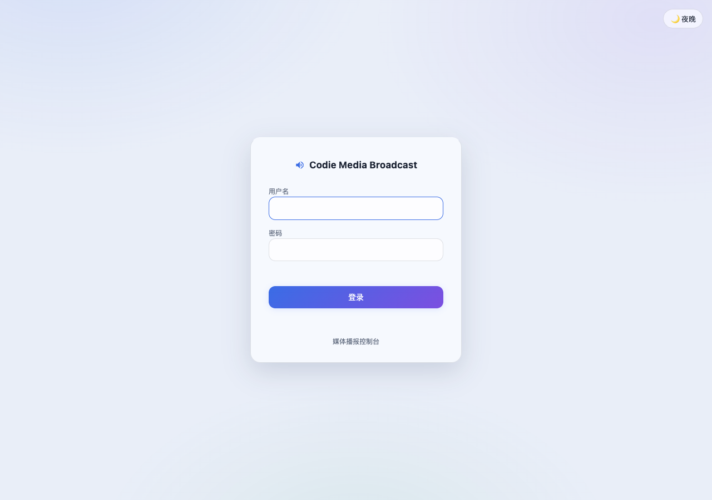

---

## 3. Home & top navigation

Top navigation (left to right): **Home, Machines, Roles, Settings, Logs**.

**Home** is the dashboard: setup-status badge, "+ Add" (opens the step-by-step wizard), device/role/binding counters, quick navigation, the device and role lists, and recent activity. A yellow banner appears if any device is not yet paired.

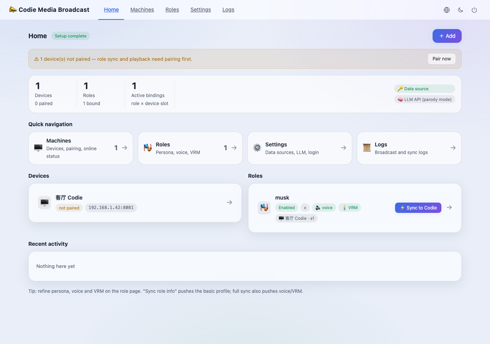

---

## 4. Bind a device (Codie pairing)

### 4.1 Add a device

1. Go to **Machines**, click **+ Add machine**.
2. Fill in:
   - **Name** — e.g. "Living-room Codie", for recognition.
   - **Address** — the device IP only (port defaults to 8081), e.g. `192.168.1.42`. The device must be on the same LAN.
   - **Authorization** — `permanent` (recommended) pairs once and lasts; `session` expires and needs re-pairing.
   - Use **📡 Scan LAN** to auto-discover devices listening on the device port.
3. Click **Add** to save.

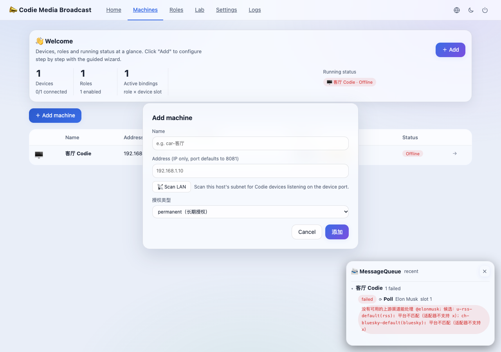

The list shows name, address, authorization, pairing and online status:

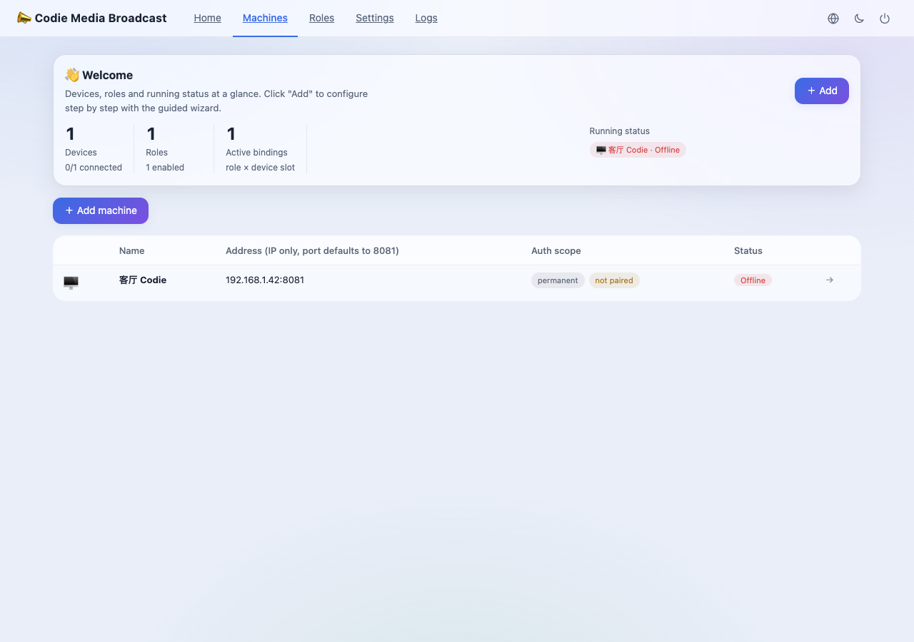

### 4.2 Pair (bind the device)

1. Click **→** on the row to open the device detail.
2. Click **Trigger pairing** (top right). The service asks the device to show a pairing dialog.
3. **On the Codie device** a 6-digit code pops up; enter it in the dialog and confirm.
4. After pairing, "Paired" shows the pairing time and the status turns **online** (green).

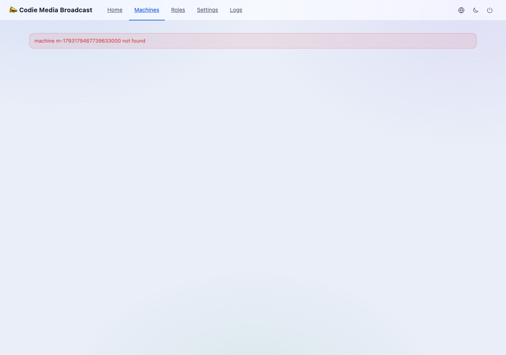

> **macOS users (local-network permission)**: macOS 15+ asks for "Local Network" permission on first scan/pair. If you clicked "Don't Allow", scanning and pairing fail silently. After such a failure, the pairing dialog and the wizard show an **Open local-network settings** button that jumps to System Settings → Privacy & Security → Local Network; allow the app and pair again.

> "Paired" means credentials exist; "Status" is current reachability. With `session` authorization, "Session expiry" shows the remaining time — re-pair after it lapses. When unpaired/offline the detail page shows the latest probe failure.

### 4.3 Enable roles on this device

Below the device detail, "Roles enabled on this machine": tick which roles are pushed to this device for broadcast and role-bundle sync; unticking disables them. Click **Open role →** to jump to editing that role.

---

## 5. Roles: persona, voice and VRM

Go to **Roles**. Each role is a full bundle (system prompt / voice / VRM / monitored account). Click a card to open the detail. The detail page has a **left rail** with three groups:

- **Workspace** — Status (bindings), Broadcast List
- **Content** — Feed
- **Role** — Persona, Settings, Logs

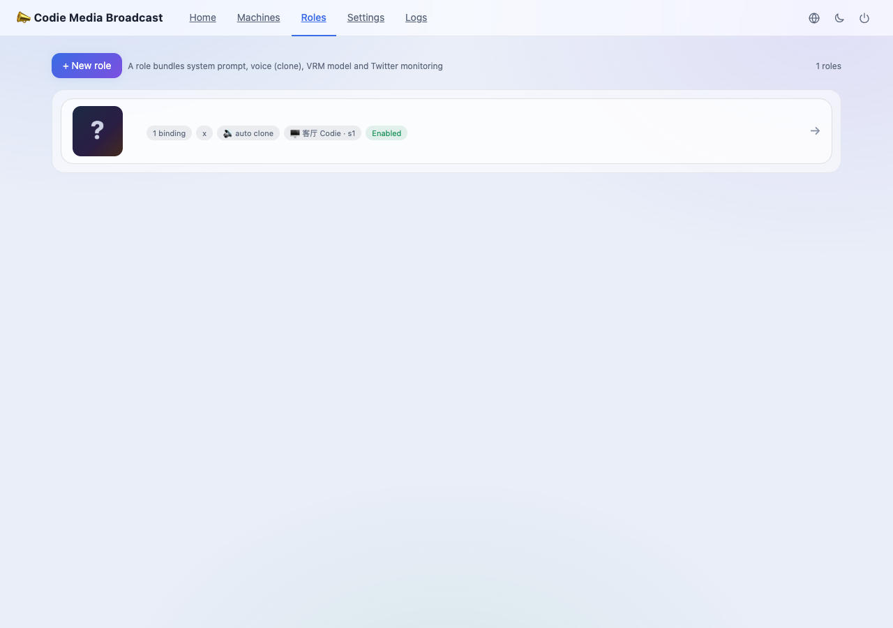

### 5.1 Create / open a role

Click **+ New role** to copy from the built-in template (Elon Musk demo), or click an existing role to open it. Rename a new role first.

### 5.2 Persona: name, prompt, voice, VRM

Role detail → **Persona**:

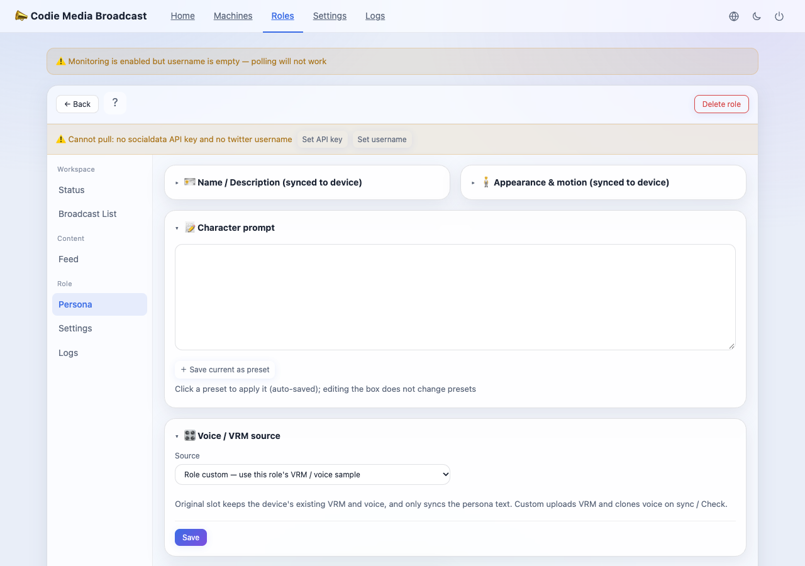

1. **Name / description** (synced to the device): the display name/description in the device's role profile; click **Save** after editing.
2. **System prompt (persona)**: the device LLM persona. When broadcasting, the post is handed to the device LLM and voiced in this style. Save common templates with "+ Save current prompt as a preset"; click a preset to apply.
3. Scroll down for **Voice (voice cloning)** and **VRM (avatar)**:

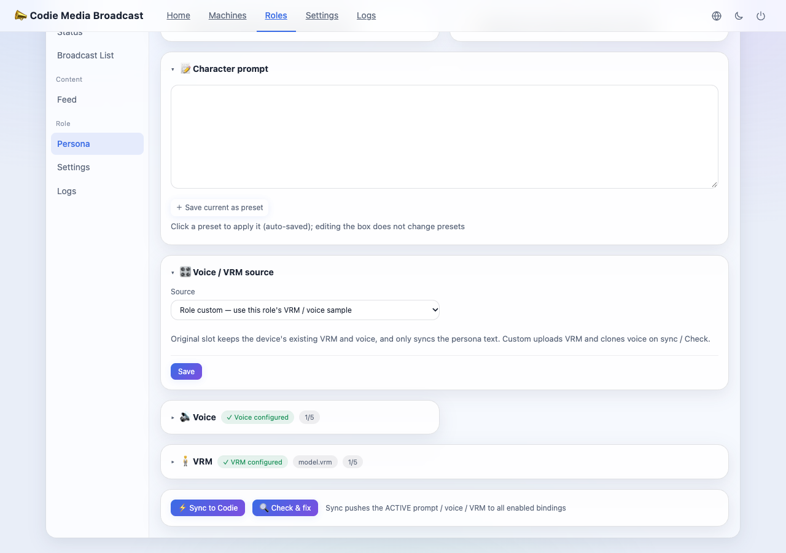

#### 5.2.1 Set the voice (voice cloning)

1. Prepare a sample: **mp3/wav, ≥ 10 s**, clean, no background noise.
2. On the Persona page, in **Voice**, click **Choose File**, pick the sample, click **Upload**.
3. After upload it is listed and marked "✓ active"; the selected sample is used by the next `voice_clone`.
4. Trigger cloning in one of two ways:
   - On the role **Status** page, expand a machine+slot binding row and click **Re-clone**;
   - or click **⟳ Sync to Codie** — with an empty voice_id/group_key, sync auto-clones and fills it in.
5. Cloning is a background job (minutes): while it runs, that machine's **Re-clone / Upload & clone** buttons are greyed out with **⏳ cloning · Ns**. A device runs one clone at a time (clone slots 21-25 are device-level). Success/failure pops a toast; jobs persist.
6. `voice_id / group_key` are recorded per machine+slot 1:1, independent per machine; edit, check or re-clone inline in the binding row.
7. Use **🔈 Check & fix** (optionally with "audition to verify the voice") to compare the device's voice/model/prompt with the role config and auto-repair differences.

#### 5.2.2 Set the VRM avatar

1. **Avatar image**: png/jpg/webp/gif (≤ 5 MB), shown on the role list. Choose a file and click **Upload avatar**.
2. **VRM model**: in the VRM block choose a `.vrm` file and click **Upload & apply**. The active model is shown afterwards (e.g. `model.vrm ✓ active`).
3. **Outfit (cloth)**: if the role has several outfits (e.g. `cloth 2`), pick one in the selector; sync/slot-switch pushes it to the device.
4. Finally click **⟳ Sync to Codie** at the bottom to push the active prompt/voice/VRM to all enabled bindings.

> Note: sync sends no outfit-conflict fields. If the device replies `OUTFIT_APPLY_REQUIRED`, confirm the outfit on the device first, then sync again.

### 5.3 Status: bind machines and slots

Role detail → **Status**:

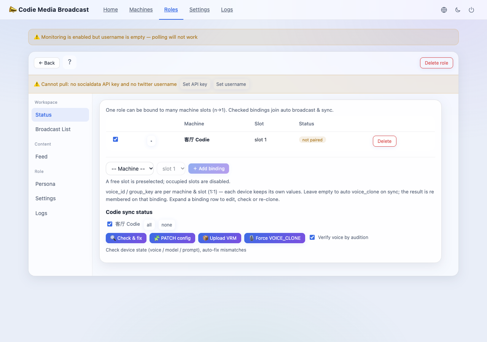

1. Pick the **machine** dropdown + the **role slot** number, click **+ Add binding**.
2. A role can bind several slots across machines (n→1); only **checked** bindings take part in automatic broadcast and sync.
3. Expand a binding row (▶) to edit that machine+slot's voice_id / group_key, check, or re-clone.
4. After voice/VRM are set, click **⟳ Sync to Codie** to push the role bundle; click **🔈 Check & fix** to verify and repair differences.

### 5.4 Settings: broadcast parameters

Role detail → **Settings**:

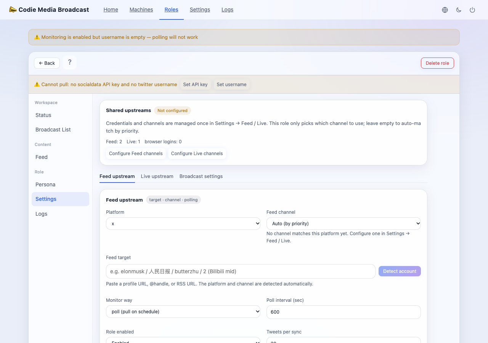

- **Platform / username**: the social account this role monitors (e.g. `elonmusk`).
- **Monitor method**: `poll` (scheduled polling) or webhook push; **poll interval (s)** controls the cadence.
- **Role enabled**: when disabled, no automatic poll/broadcast (manual broadcast still works).
- **Upstream source**: which upstream API to use (the first enabled one for the platform is used).
- **TTS volume**: device read volume (0–100).
- **Language**: broadcast language (e.g. `en` / `zh`).

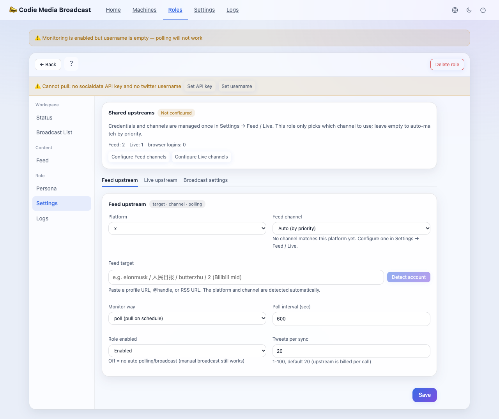

- **Repeat count / interval (s)**: how many times a post is read and how far apart.
- **Posts per sync**: 1-100, default 20 (the upstream bills per request).
- **No-body posts**: posts that are pure image/video have no readable text; default "skip".
- **Broadcast mode**: `tts · plain TTS` (default, reads the post body directly); with an LLM configured, an LLM-colloquial mode is available, plus a tts-colloquial toggle and conversion prompt.
- **Avatar gender (animation) / animation intensity**: usually "keep the device's current value".
- Click **Save** when done.

---

## 6. Data source & API key

The **Settings** page has sub-tabs: Account, Feed (API keys & webhook), Advanced, Upstreams.

### 6.1 Feed sub-tab (socialdata.tools)


1. Register at [socialdata.tools/dashboard/api-keys](https://socialdata.tools/dashboard/api-keys) and get an API key (pay-as-you-go): **Generate API key** on the dashboard's Overview page, then paste it here.
2. Paste the key into **socialdata.tools API key (default fallback for twitter)** and click **Save**. It takes effect immediately without restart and is masked on the page.

### 6.2 Account

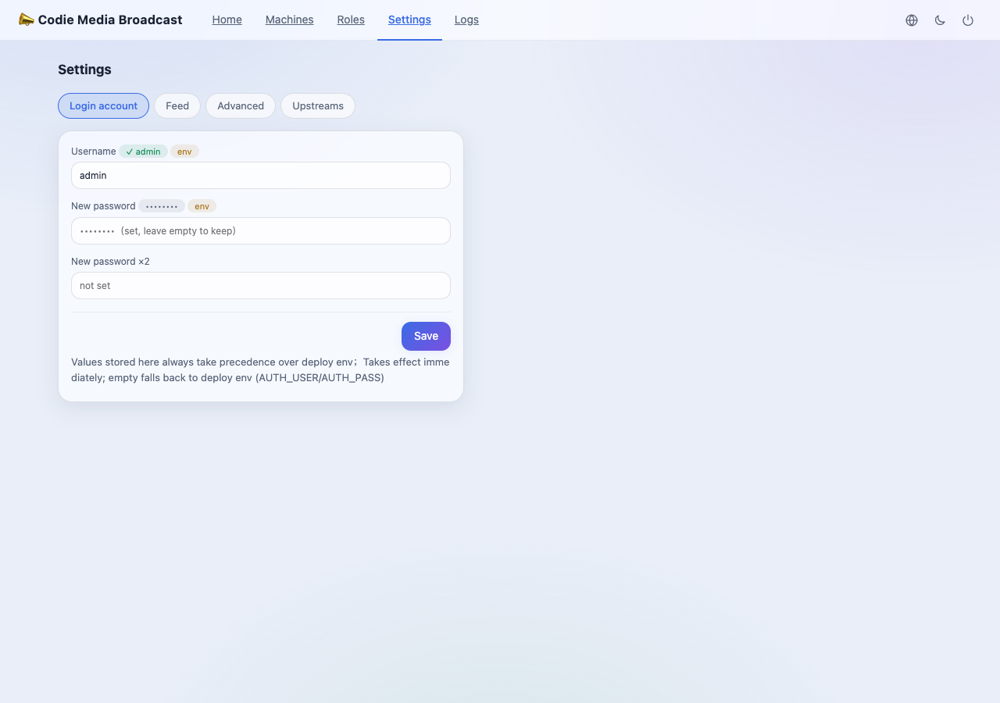

Change the console sign-in username/password. Values saved here always take priority over the deployment env; they take effect immediately. When empty, the value falls back to env (`AUTH_USER` / `AUTH_PASS`), then the default `admin / 11111`.

### 6.3 Upstreams (multiple sources)


- Click **+ Add upstream** to connect several data sources (name, API type, key, base_url, cookie, poll interval, enable toggle).
- Each row can be **Test**ed (one fetch, showing count and latency) or deleted.
- Without a dedicated upstream, the default socialdata.tools key from 6.1 is used as the fallback.

---

## 7. Broadcasting posts

### 7.1 Feed: manual broadcast and broadcast modes

Role detail → **Feed**. Feed has four sub-tabs: **Feed List (default manual), Random, Parody, Watch**:

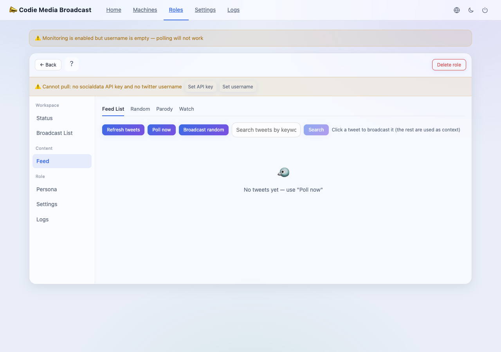

**Feed List (manual)**:

- **Refresh tweets**: reload the fetched list.
- **Poll now**: immediately pull the role's new posts from the upstream (needs an API key).
- **Broadcast one at random**: pick a random recent post and send it to the device to read.
- **Search posts by keyword**, then **Search** to filter; clicking any post broadcasts it (the rest serve as context).

**Watch**: the per-account watch toggle and poll interval. Watch only pulls new posts into the cache — it does not broadcast; what to broadcast is up to each broadcast mode's own rules:

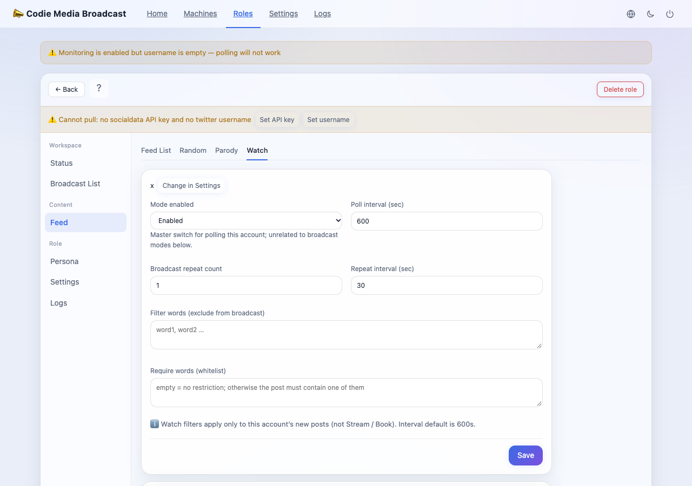

**Random / Parody**: the config of the two automatic broadcast modes (checked-pool partitioning, filters, parody copy generation), configured independently; parody needs an LLM API under Settings → Feed.

The **Broadcast List** tab (under Workspace) is the checked pool used by random/parody broadcasting:

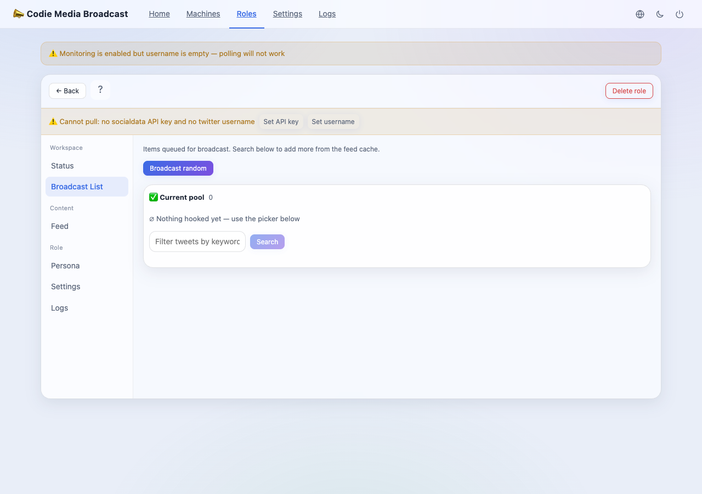

Before broadcasting, confirm: the machine is paired and online, the role is bound to the machine's slot, and the role bundle has been synced (or sync-on-broadcast is ticked).

### 7.2 Automatic broadcast

1. On the role **Settings** tab, configure the monitor method (poll + interval, or webhook) and save.
2. Confirm the machine bound to the role (checked on the Status tab) is online.
3. The service polls on the interval (or receives webhook pushes) and, on a new post, pushes the role bundle and calls the device to broadcast.

---

## 8. Logs & troubleshooting

Go to **Logs**:

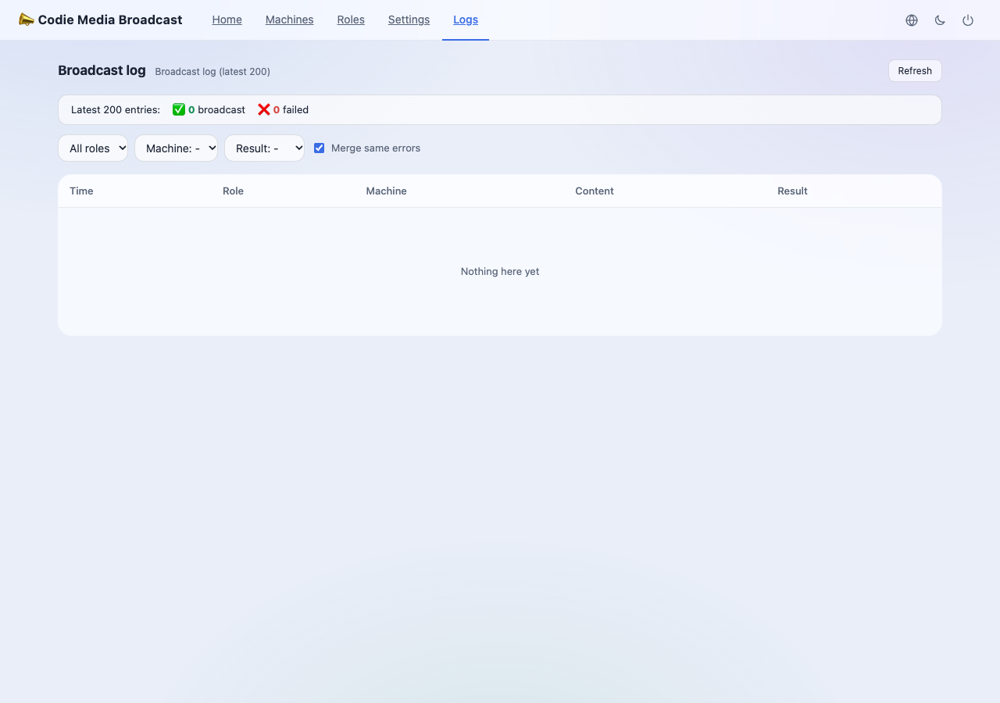

- Shows the last 200 broadcast records: time, role, content, result; a top counter of **broadcast / failed**.
- Filter by **role / result**; tick "group identical errors" to collapse repeats; click **Refresh** to update.
- Troubleshooting:
  - Device offline/unpaired → check status on Machines, **trigger pairing** again;
  - Fetch failure → check the API key / upstream in Settings, verify with **Test**;
  - Wrong voice/persona → click **🔈 Check & fix** on the role;
  - System-level errors → see the role detail **Logs** tab for the detailed trace.

---

## 9. FAQ

| Issue | Fix |
|---|---|
| Pairing fails after entering the code | Confirm the device is on the same LAN and the address/port (default 8081) is correct; the code is single-use — re-trigger pairing and use the new code shown on the device |
| macOS finds no devices / pairing keeps failing | macOS 15+ "Local Network" permission was denied (prompted on first run): use the **Open local-network settings** button shown after the failure, or System Settings → Privacy & Security → Local Network, allow the app, then scan/pair again |
| Device shows "offline" though paired | "Paired" only means credentials exist; check the device power/network — the detail page re-probes automatically |
| `OUTFIT_APPLY_REQUIRED` error | The request must not carry the outfit field; confirm the outfit on the device, then sync again |
| No posts fetched | In Settings, check the socialdata.tools key is valid and funded; verify connectivity with the upstream **Test** button |
| Voice does not match the role | Expand the binding row and re-clone, or "Sync to Codie" to auto-clone and backfill; then run Check & fix |
| Do I need a restart after changing the key | No — Settings saves take effect immediately (database config takes priority over env) |
| Webhook pushes not arriving | Check the public URL is reachable and the signing secret matches the dashboard; after adding/removing roles, re-run "create/sync search monitor" |
