# Codie Media Broadcast 使用手册

> 监控社媒账号，让 Codie 设备用自定义人设和音色把新帖播报出来。本手册基于当前界面逐步截图，覆盖安装、设备配对、人设/音色/VRM 设置、数据源 API Key 与完整播报流程。

**目录**

1. 产品简介与整体流程
2. 安装（macOS / Windows / Linux / Docker）
3. 首页与顶部导航
4. 绑定设备（Codie 配对）
5. 角色：人设、音色与 VRM
6. 数据源与 API Key
7. 推文播报（手动 / 自动）
8. 播报日志与排错
9. 常见问题 FAQ

---

## 1. 产品简介与整体流程

- **设备**：一台 Codie 设备 = 一份授权配置。页面上添加设备地址后一键触发配对（输入设备上弹出的 6 位配对码完成）。
- **角色**：`system prompt / 克隆音色 / VRM 形象 / 监控账号` 打包为一个整体，内置可编辑的 demo（Elon Musk）。
- **监控播报**：多个社媒账号 → 各自映射到角色 + 设备，服务按间隔轮询上游拉取新帖，把角色包下发到设备后经 `chat/text` 让 Codie 朗读。

**推荐操作顺序**：登录 → 添加设备并完成配对 → 配数据源 API Key → 新建/编辑角色（人设 + 音色 + VRM）→ 角色绑定设备槽位 → 同步角色 → 开启监听/手动播报。

---

## 2. 安装

### 2.1 桌面端（推荐）

从最新 [GitHub Release](https://github.com/codiebitcoin/twitter_read_play/releases) 下载对应安装包，打开即进控制台窗口。

| 平台 | 安装包 | 说明 |
|---|---|---|
| macOS | `Twitter Read Play.app` + `.dmg`（通用二进制） | 首次打开拦截见下 |
| Windows | `Twitter Read Play.exe`（免安装）/ `Setup`（NSIS） | 依赖 WebView2（Win10/11 自带） |
| Linux | `.AppImage` / `.deb` / `.tar.gz` | 依赖 WebKitGTK（`libwebkit2gtk-4.1-0`） |

**macOS 首次打开拦截（隔离属性）**。安装包未做 Apple 开发者签名/公证，浏览器下载的包带 quarantine 标记。若首次打开被拦（「无法验证开发者」或「已损坏，移到废纸篓」），按顺序尝试：

1. 双击 App，若提示无法验证开发者，点 **完成**（不要点「移到废纸篓」），再打开 **系统设置 → 隐私与安全性**，滚到底部「安全性」，点 **仍要打开**。
2. 若没有该提示，打开「终端」执行下面命令后重新双击：

```bash
xattr -dr com.apple.quarantine /Applications/Twitter\ Read\ Play.app
```

### 2.2 服务端（Docker）

用 GHCR 现成镜像一条命令启动，浏览器访问控制台：

```bash
docker run -d -p 8080:8080 -v trp-data:/app/data \
  -e AUTH_USER=admin -e AUTH_PASS=change-me \
  ghcr.io/codiebitcoin/twitter_read_play:latest
# 打开 http://localhost:8080 登录
```

登录账号密码用环境变量设置；页面保存的优先：**设置 → 登录账号 > env（`AUTH_USER` / `AUTH_PASS`）> 默认 `admin / 11111`**。

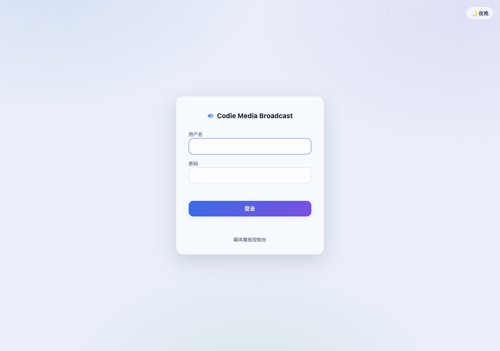

---

## 3. 首页与顶部导航

顶部导航（从左到右）：**首页、机器、角色、设置、日志**。

**首页**是总览：配置状态徽标、「＋ 添加」（打开分步向导）、设备/角色/有效绑定统计、快速导航、设备与角色列表、最近动态。若有设备未配对，顶部会出现黄色提示条。

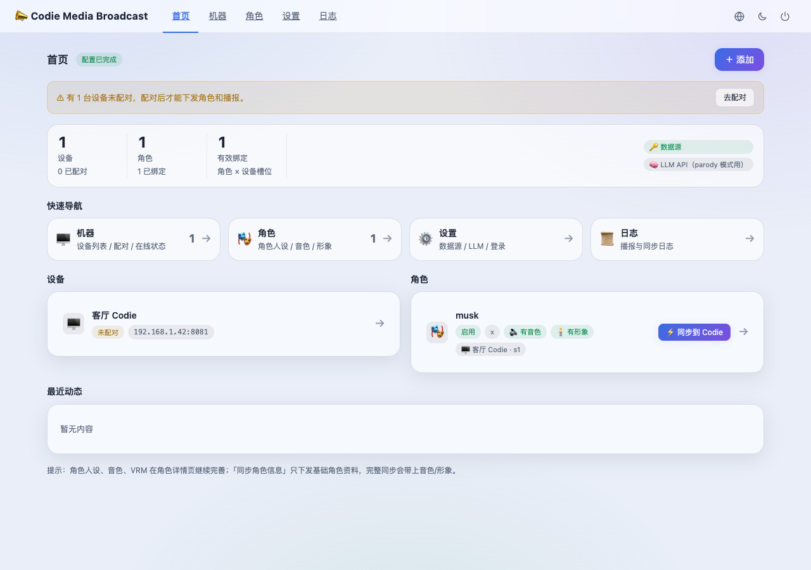

---

## 4. 绑定设备（Codie 配对）

### 4.1 添加设备

1. 进入 **机器** 页，点 **＋ 添加机器**。
2. 填写：
   - **名称**：如「客厅 Codie」，便于识别。
   - **设备地址**：只填设备 IP（端口默认 8081），如 `192.168.1.42`。设备需与服务在同一局域网。
   - **授权类型**：`permanent`（推荐）配对一次长期有效；`session` 到期后需重新配对。
   - 可用 **📡 扫描局域网** 自动发现监听设备端口的 Codie。
3. 点 **添加** 保存。

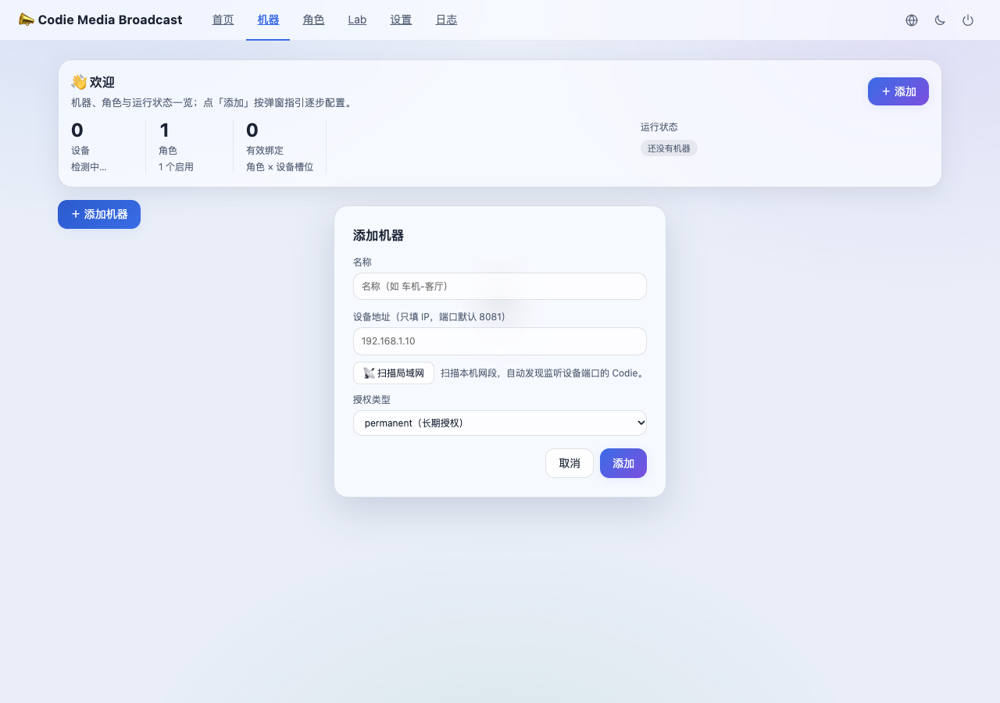

列表显示名称、地址、授权类型、配对状态与在线状态：

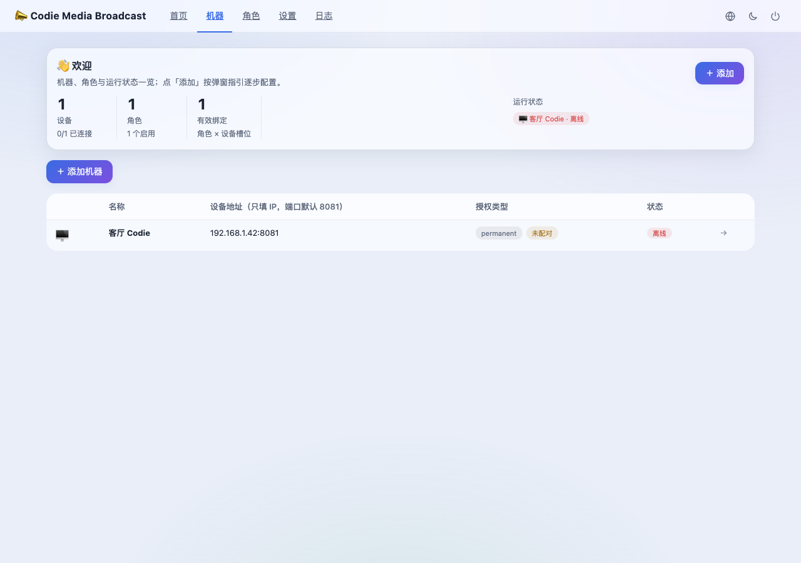

### 4.2 触发配对（绑定设备）

1. 点该行的 **→** 进入机器详情。
2. 点右上角 **触发配对**，服务会让设备弹出配对窗口。
3. **在 Codie 设备上**会显示 6 位配对码，填入弹窗并确认。
4. 配对成功后，「已配对」显示配对时间，「状态」变为 **在线**（绿色）。

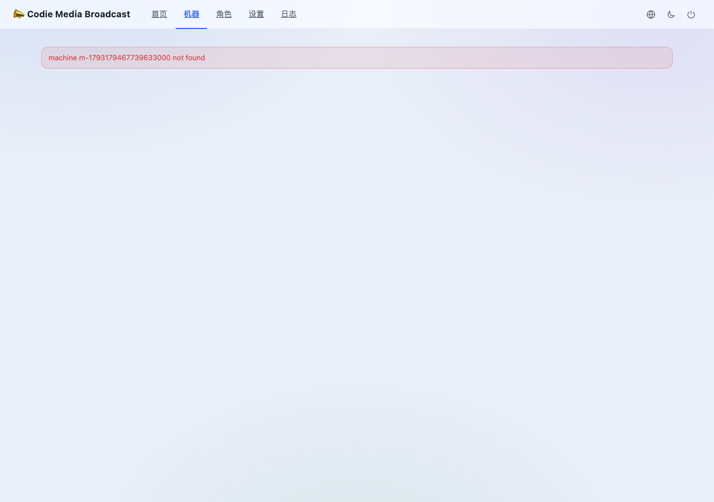

> **macOS 用户注意（本地网络授权）**：macOS 15+ 首次扫描/配对时会弹「本地网络」授权弹窗；若点了「不允许」，扫描和配对都会静默失败。此类失败后，配对弹窗与向导会出现 **打开局域网授权设置** 按钮，一键跳到 系统设置 → 隐私与安全性 → 本地网络，允许本应用后重新配对即可。

> 说明：「已配对」表示凭据存在；「状态」表示当前是否可达。`session` 授权会在「会话到期」处显示剩余时间，过期后重新配对即可。未配对/离线时详情页会显示最近一次检测失败原因。

### 4.3 本机启用角色

机器详情下方「本机启用的角色」：勾选哪些角色，播报与角色包同步就会下发到这台机器；取消勾选即停用。点 **进入角色 →** 可跳转编辑该角色。

---

## 5. 角色：人设、音色与 VRM

进入 **角色** 页：每个角色是一个完整包（system prompt / 音色 / VRM / 监控账号）。点卡片进入详情。详情页**左侧导航**分三组：

- **工作台** — Status（绑定）、Broadcast List
- **内容** — Feed
- **角色** — Persona、角色设置、系统日志

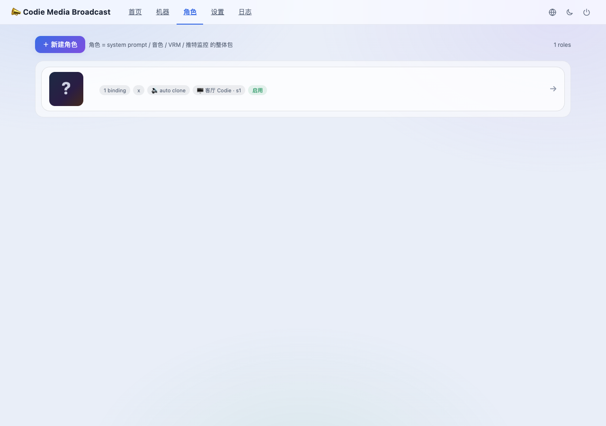

### 5.1 新建 / 进入角色

点 **＋ 新建角色** 从内置模板（Elon Musk demo）复制创建，或在列表点已有角色进入。新角色建议先改名再编辑。

### 5.2 Persona：名称、人设 prompt、音色、VRM

角色详情 → **Persona** 子页：

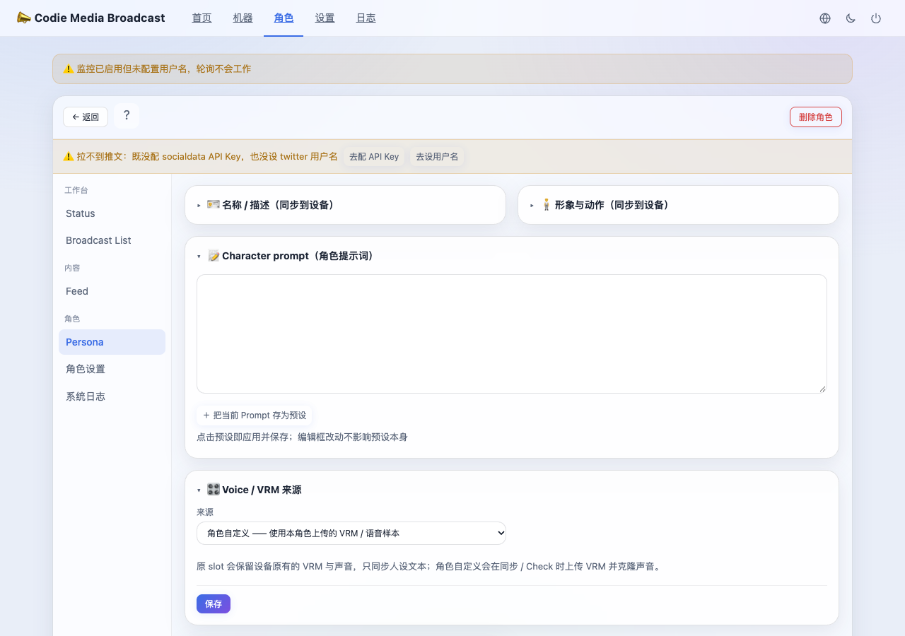

1. **名称 / 描述**（同步到设备）：设备角色资料里展示的名称与描述，改完点 **保存**。
2. **System Prompt（人设）**：设备端 LLM 的人设 prompt。播报时把推文交给设备 LLM 按此风格口语化。可用「＋ 把当前 Prompt 存为预设」保存常用模板，点击预设即应用。
3. 向下滚动是 **Voice（声音克隆）** 与 **VRM（形象）** 两个区块：

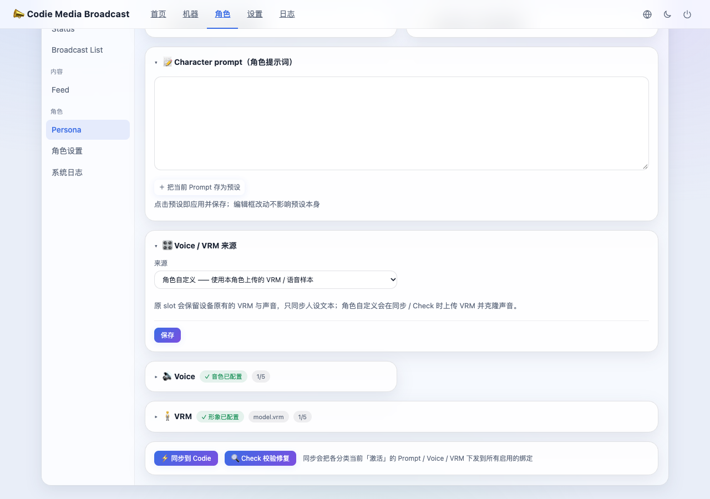

#### 5.2.1 设置音色（Voice / 声音克隆）

1. 准备语音样本：**mp3/wav，建议 10 秒以上**，音质清晰、无背景噪音。
2. 在 Persona 页 **Voice** 区块点 **Choose File** 选择样本文件，点 **上传样本**。
3. 上传成功后样本会列出并显示「✓ 激活」；该样本将在下一次触发 `voice_clone` 时使用。
4. 克隆触发时机（二选一）：
   - 在角色 **Status** 页展开某条「机器+槽位」绑定行，点 **重新克隆**；
   - 或直接点 **⟳ 同步到 Codie**：留空 voice_id/group_key 时，同步会自动克隆并回填。
5. 克隆为后台任务（分钟级）：进行中该机器的 **重新克隆 / 上传并克隆** 按钮会变灰，并显示 **⏳ 克隆中 · Ns**；同一台设备同时只跑一个克隆（克隆槽 21-25 为设备级资源）。完成/失败会弹提示，任务记录由后台持久化。
6. `voice_id / group_key` 按「机器+槽位」1:1 记录，**每台机器各自独立**；可在绑定行内手动编辑、检查或重新克隆。
7. 可用 **🔈 Check 校验修复**（勾选「试听验证音色」）核对设备上 voice / model / prompt 是否与角色配置一致，不一致会自动修复。

#### 5.2.2 设置 VRM 形象

1. **头像图片**：png/jpg/webp/gif（≤5MB），用于角色列表展示。选择文件后点 **上传头像**。
2. **VRM 模型**：在 VRM 区块选择 `.vrm` 模型文件，点 **上传并应用**。上传成功后显示当前激活的模型（如 `model.vrm ✓ 激活`）。
3. **服装（cloth）**：如角色有多个服装（如 `cloth 2`），可在对应选择框选择；同步/切换槽位时下发到设备。
4. 最后点底部 **⟳ 同步到 Codie**，把各分类当前「激活」的 Prompt / Voice / VRM 下发到所有启用的绑定。

> 注意：同步时请求不带服装冲突字段；若设备提示 `OUTFIT_APPLY_REQUIRED`，先在设备端确认服装后再同步。

### 5.3 Status：绑定机器与槽位

角色详情 → **Status** 子页：

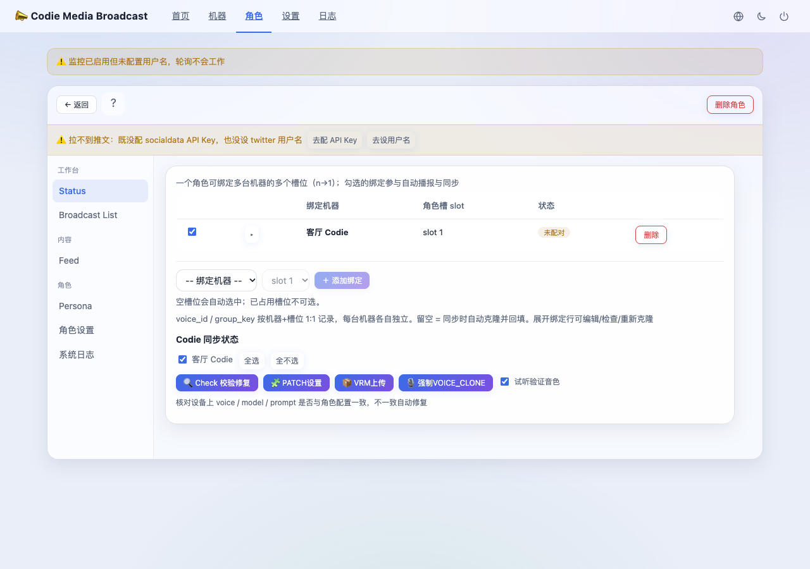

1. 选择 **绑定机器** 下拉框 + **角色槽 slot** 号，点 **＋ 添加绑定**。
2. 一个角色可绑定多台机器的多个槽位（n→1）；**勾选**的绑定才参与自动播报与同步。
3. 展开绑定行（▶）可编辑该「机器+槽位」的 voice_id / group_key、检查或重新克隆。
4. 配好音色/VRM 后，点 **⟳ 同步到 Codie** 下发角色包；点 **🔈 Check 校验修复** 自动核对并修复差异。

### 5.4 角色设置：播报参数

角色详情 → **角色设置** 子页：

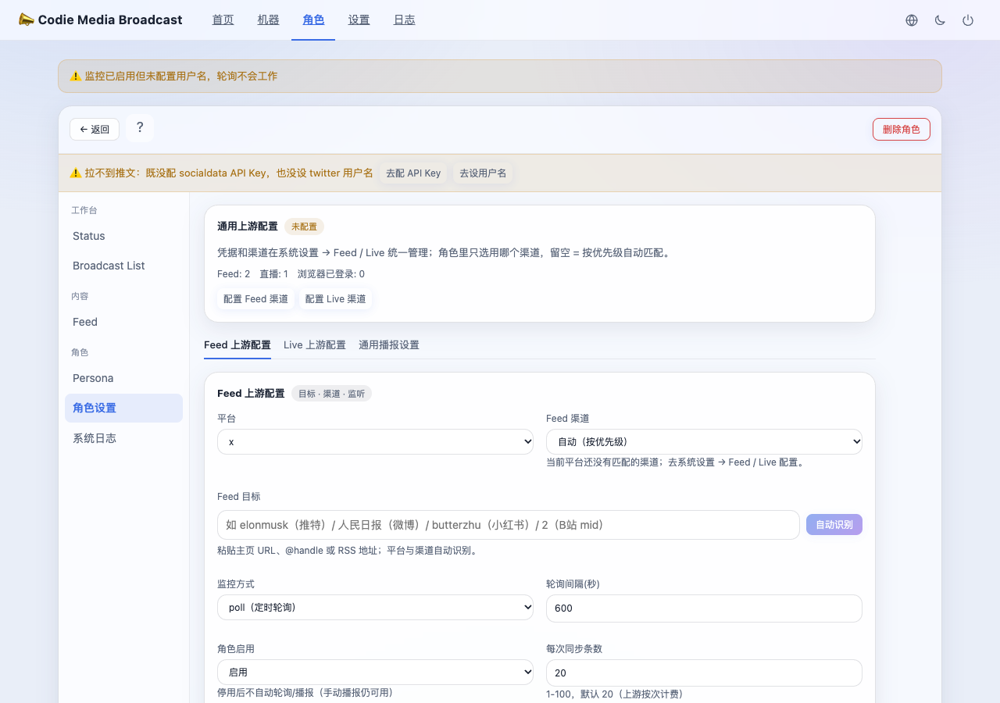

- **平台 / 用户名**：该角色监控的社媒账号（如 `elonmusk`）。
- **监控方式**：`poll（定时轮询）` 或 webhook 推送；**轮询间隔（秒）** 控制拉取频率。
- **角色启用**：停用后不自动轮询/播报（手动播报仍可用）。
- **上游数据源**：选择使用的上游 API（多上游时按平台选第一个启用的）。
- **TTS 音量**：设备朗读音量（0–100）。
- **语言**：播报语言（如 `en` / `zh`）。

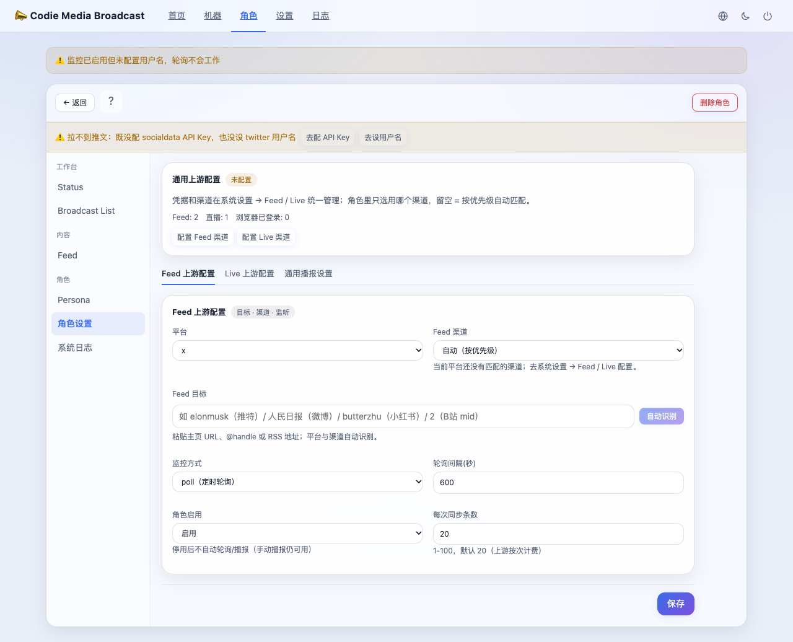

- **播报重复次数 / 重复播报间隔（秒）**：同一条推文重复朗读的次数与间隔。
- **每次同步条数**：1-100，默认 20（上游按次计费）。
- **无正文推文**：纯图片/视频推文没有可读正文时，默认「跳过」不参与播报。
- **播报模式**：`tts · 纯 TTS`（默认，直接朗读推文正文）；配置 LLM 后可选 LLM 口语化模式，并出现 tts 口语化开关与转换 prompt。
- **形象性别（动作动画）/ 动作幅度**：一般「沿用设备当前值」。
- 改完点 **保存**。

---

## 6. 数据源与 API Key

**设置** 页含子页：登录账号、Feed（API Keys 与 webhook）、高级、上游数据源。

### 6.1 浏览器登录（默认拉取方式）

**浏览器登录**卡片是默认的数据源：平台登录一次，应用就能用页面自身接口读取数据——免 API Key（仅桌面端）。

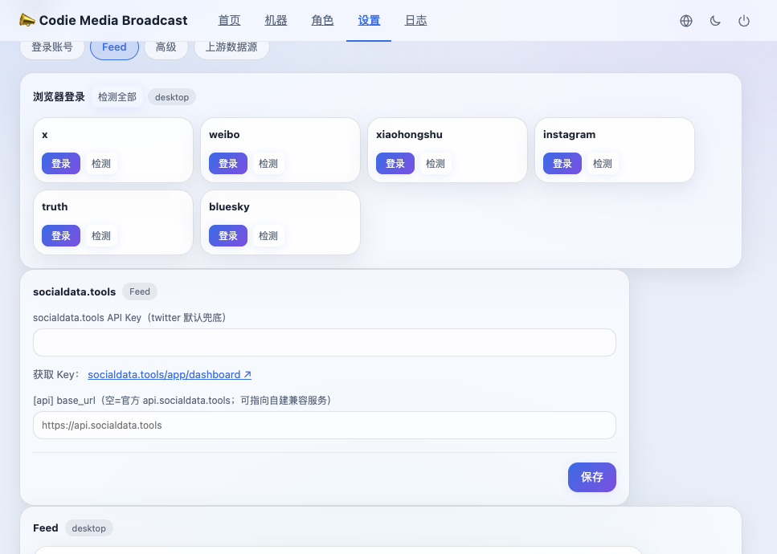

1. 设置 → Feed → **浏览器登录**，在平台卡片（如 `x`）上点 **登录**。
2. 应用会打开内置浏览器窗口，进入该平台的登录页——正常登录即可：

   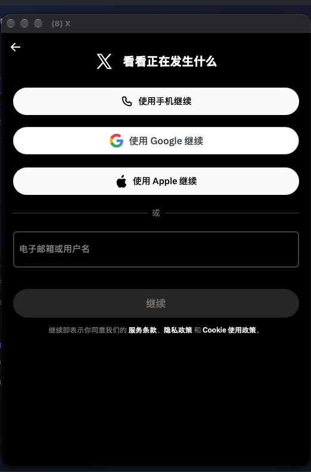

3. 登录成功后，卡片显示已连接的账号（「✓ 已连接 · 你的账号」）。随时可用每张卡的 **检测** 或顶部 **检测全部** 复核；会话过期后再点一次 **登录** 即可。
4. 此后，渠道选「自动（按优先级）」的角色会自动经由这条已登录的内置浏览器渠道拉取。

> 提示：所有需要登录的入口（添加向导的「去设置页登录」、首页的 🔑 数据源徽标）都会通过 `设置 → #feed/browser-login` 直接落到这张卡片。

### 6.2 Feed 子页（socialdata.tools，可选）

更想走云端拉取？到 [socialdata.tools/dashboard/api-keys](https://socialdata.tools/dashboard/api-keys) 注册并生成 API Key（按量计费），在 Feed 子页粘贴到 **socialdata.tools API Key（twitter 默认兜底）**，点 **保存**——保存即时生效，无需重启。


### 6.3 登录账号


可修改控制台登录用户名/密码。此处保存的配置始终优先于部署 env；保存后立即生效；为空时依次回落到部署 env（`AUTH_USER/AUTH_PASS`）、默认值 `admin / 11111`。

### 6.4 上游数据源（多 API 源）

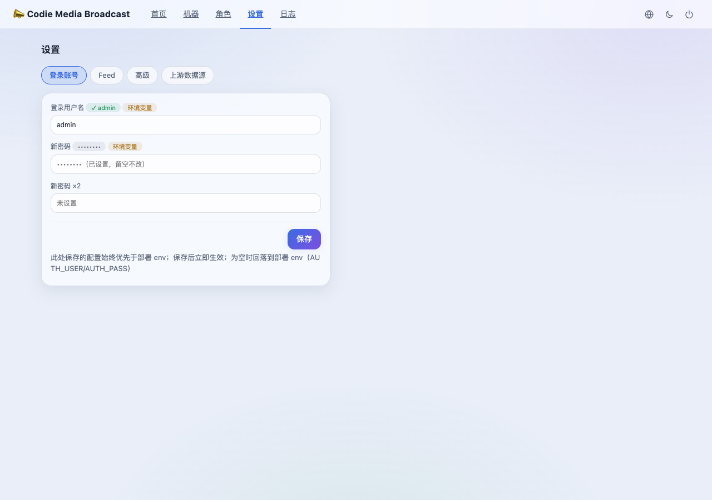

- 点 **＋ 添加上游**，可接入多个数据源（名称、API 类型、Key、base_url、Cookie、轮询间隔、启用开关）。
- 每行可 **测试**（试拉一次推文，显示条数与耗时）或删除。
- 未配置专用上游时，使用 6.2 的默认 socialdata.tools Key 兜底。

---

## 7. 推文播报

### 7.1 Feed：手动播报与播报模式

角色详情 → **Feed** 子页。Feed 顶部有四个子标签：**Feed List（默认手动播报）、random（随机）、parody（仿写）、监听**：

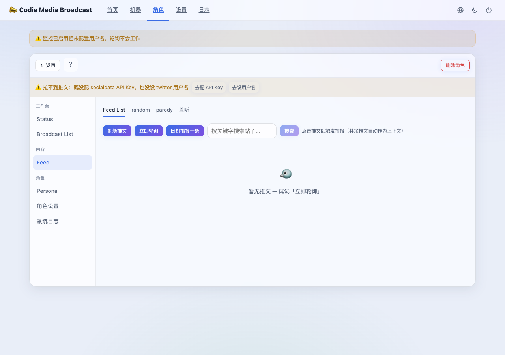

**Feed List 标签（手动播报）**：

- **刷新推文**：刷新已拉取的推文列表。
- **立即轮询**：立刻从上游拉取该角色用户新推文（需已配置 API Key）。
- **随机播报一条**：从最新推文中随机挑一条下发给设备朗读。
- **按关键字搜索帖子**后点 **搜索** 可筛选，点击任意推文即触发播报（其余推文自动作为上下文）。

**监听标签**：该账号的监听总开关与轮询间隔。监听只负责把新帖拉进缓存、**不播**；播不播、播哪些由各播报模式自己的规则决定：

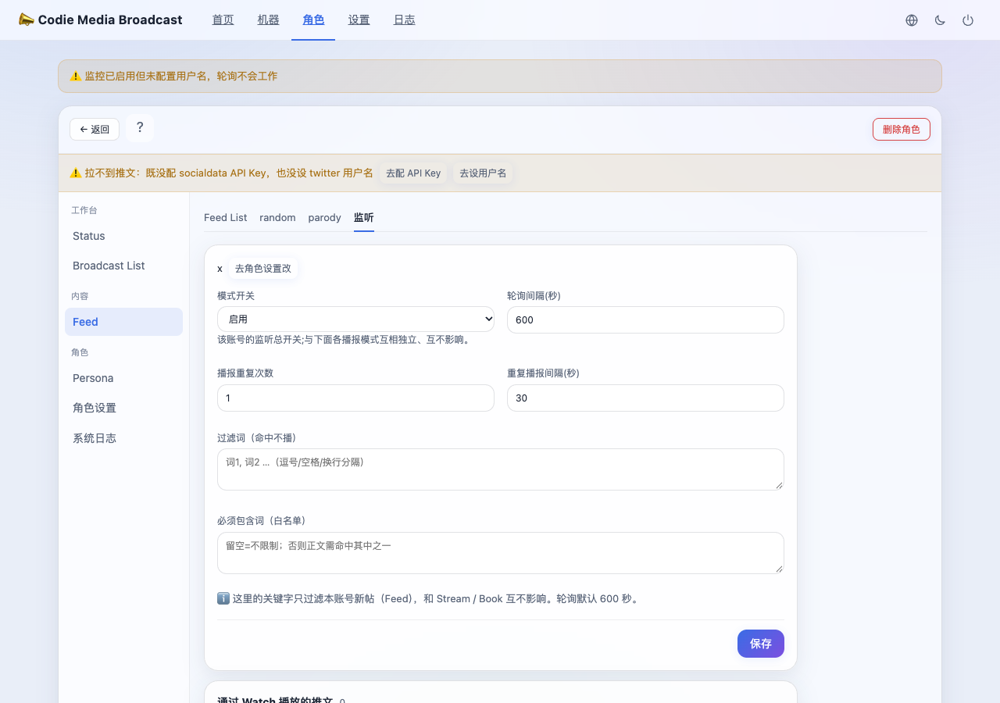

**random / parody 标签**：两种自动播报模式的配置（勾选池分区、筛选组件、parody 文案生成等），按模式归属各自独立配置；parody 模式需在「设置 → Feed」配置 LLM API。

**工作台 → Broadcast List** 是 random/parody 播报用的勾选池：

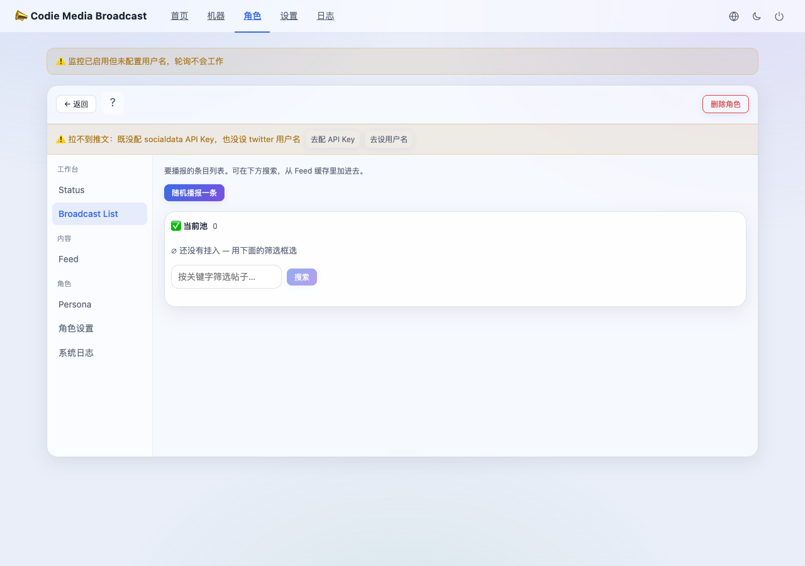

播报前请确认：机器已配对且在线、角色已绑定该机器槽位、角色包已同步（或勾选了播报时自动同步）。

### 7.2 自动播报

1. 在角色 **角色设置** 页配置监控方式（poll + 轮询间隔，或 webhook 模式）并保存。
2. 确认角色绑定（Status 页勾选）的机器在线。
3. 服务按间隔轮询（或接收 webhook 推送），发现新推文后自动下发角色包并调用设备播报。

---

## 8. 播报日志与排错

进入 **日志** 页：

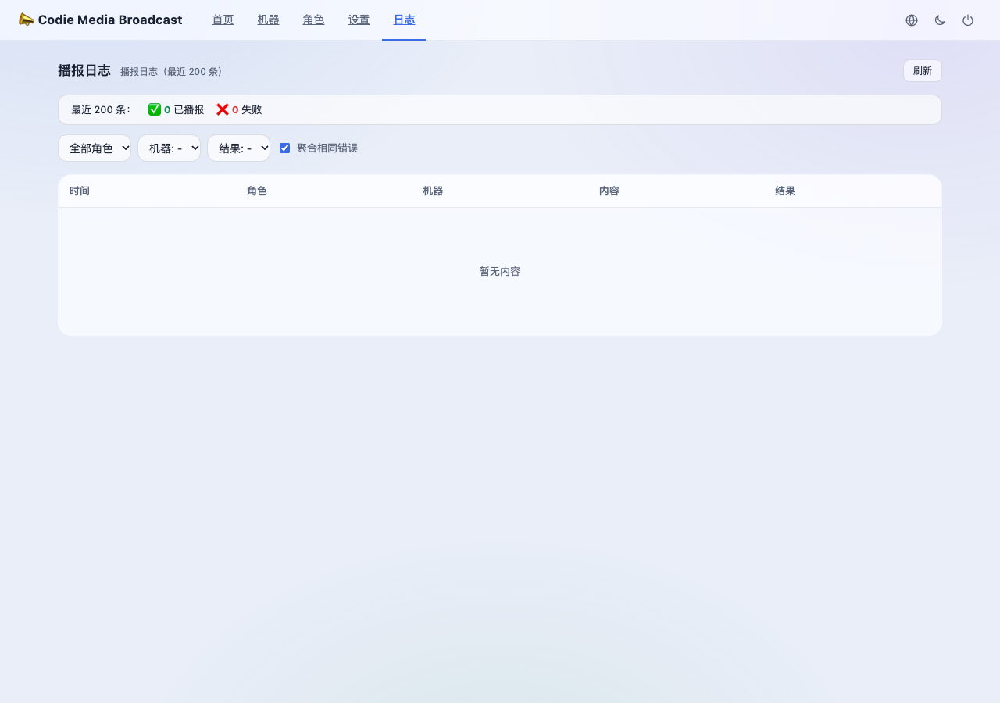

- 展示最近 200 条播报记录：时间、角色、内容、结果；顶部统计 **已播报 / 失败** 数量。
- 可按 **角色 / 结果** 过滤，勾选「聚合相同错误」合并重复报错；点 **刷新** 更新。
- 排错路径：
  - 设备离线/未配对 → 机器页看状态，重新 **触发配对**；
  - 拉取失败 → 设置页检查 API Key / 上游，用「测试」验证；
  - 音色/人设不符 → 角色页点 **🔈 Check 校验修复**；
  - 系统级报错 → 角色详情 **系统日志** 子页查看详细流水。

---

## 9. 常见问题 FAQ

| 问题 | 处理 |
|---|---|
| 配对码输入后失败 | 确认设备与服务同网段、地址端口正确（默认 8081）；配对码是一次性的，重新点「触发配对」用设备新弹出的码 |
| Mac 扫描不到设备/配对一直失败 | macOS 15+ 的「本地网络」授权被拒绝过（首次会弹窗）：在报错后出现的 **打开局域网授权设置** 按钮，或手动去 系统设置 → 隐私与安全性 → 本地网络 允许本应用，再重新扫描/配对 |
| 设备显示「离线」但已配对 | 「已配对」仅代表凭据存在；检查设备电源/网络，详情页会自动重测 |
| `OUTFIT_APPLY_REQUIRED` 报错 | 请求不允许携带服装字段；在设备端先确认服装，再重新同步 |
| 拉取不到推文 | 设置页检查 socialdata.tools Key 是否有效、是否欠费；上游「测试」按钮验证连通 |
| 音色和角色不符 | 绑定行展开重新克隆，或直接「同步到 Codie」自动克隆回填；再用 Check 校验修复 |
| 改了 Key 要重启吗 | 不需要，设置页保存后立即生效（数据库配置优先于 env） |
| webhook 推送收不到 | 检查公网地址可达、签名密钥与 dashboard 一致；角色增删后重新「创建/同步 search monitor」 |
